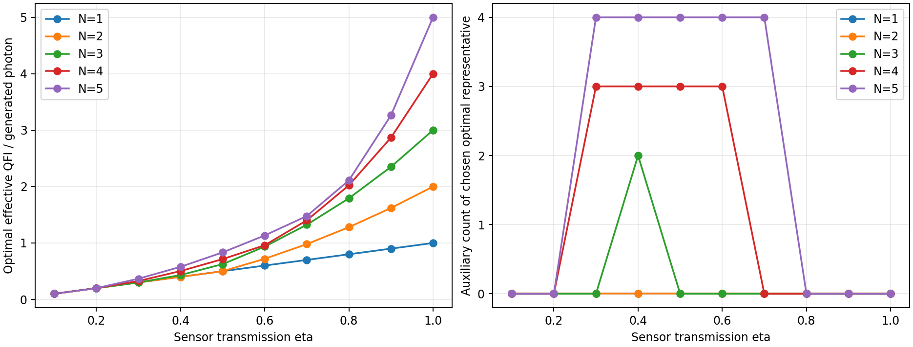
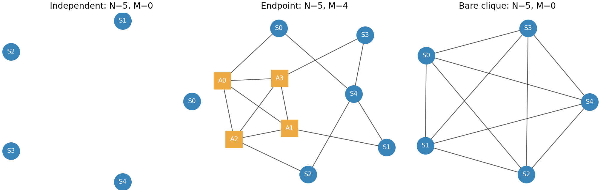

# 確率混合なし・補助XYZ測定による1〜5センサの最適化

センサ数N=1〜5、補助数M=0〜N、透過率eta=0.1,0.2,…,1.0の10点を比較した。
**50条件すべてで、確定的な構成の達成値と、全候補グラフに対する上界が一致した。**
設定の選択確率を最適化する処理は使っていない。6センサ以上の探索や時間計測のためのベンチマークも含めていない。

## 結果

評価量は全生成光子数当たりの有効QFI、F_eff/(N+M)。各Nを固定して比較する。
以下は代表最適解であり、同率になる全グラフ・全補助数を列挙したものではない。

|N|独立センサ M=0|補助N−1個の上限達成構成|補助なし完全グラフ M=0|
|---:|---|---|---|
|1|0.1〜1.0|—|—|
|2|0.1〜0.5|代表解には未選択|0.6〜1.0|
|3|0.1〜0.3|0.4：M=2|0.5〜1.0|
|4|0.1〜0.2|0.3〜0.6：M=3|0.7〜1.0|
|5|0.1〜0.2|0.3〜0.7：M=4|0.8〜1.0|

この表の範囲は**0.1刻みの評価点の集まり**であり、間の連続区間での最適性は主張しない。
N=2, eta=0.5では独立・完全グラフ・M=1の構成が同率。N=5, eta=0.2では独立とM=4が同率。
その他の全同率解については未列挙。既知の参照構成同士の同率はsummary.jsonに記録した。

### 最適なF_eff/(N+M)

|透過率 eta|N=1|N=2|N=3|N=4|N=5|
|---:|---:|---:|---:|---:|---:|
|0.1|0.100000|0.100000|0.100000|0.100000|0.100000|
|0.2|0.200000|0.200000|0.200000|0.200000|0.200000|
|0.3|0.300000|0.300000|0.300000|0.325714|0.366667|
|0.4|0.400000|0.400000|0.432000|0.502857|0.577778|
|0.5|0.500000|0.500000|0.625000|0.714286|0.833333|
|0.6|0.600000|0.720000|0.936000|0.960000|1.133333|
|0.7|0.700000|0.980000|1.323000|1.401400|1.477778|
|0.8|0.800000|1.280000|1.792000|2.022400|2.109440|
|0.9|0.900000|1.620000|2.349000|2.867400|3.261870|
|1.0|1.000000|2.000000|3.000000|4.000000|5.000000|




## モデルと操作条件

- 単純無向CZグラフ状態。センサは頂点0,…,N−1、補助はN,…,N+M−1。
- センサだけが独立な透過率etaの消失を受け、補助は保持される。
- 消失は未知位相の付与前。損失位置が補助測定前に、センサを消費せず分かる理想条件。
- 各損失パターンで補助のXYZ測定基底を確定的に選ぶ。補助結果に応じて、生存センサに単一量子ビットClifford操作を行う。
- 操作の順序は、損失把握→補助測定→センサ局所操作→未知位相付与。
- 設定の確率混合は使わない。CSVのoutcome_probabilityは量子測定の結果確率であり、最適化した設定選択確率ではない。
- 各地点の位相phi_iは独立に未知。U_i=exp[−i phi_i (I−Z_i)/2]、目標は全N地点の平均。
- 損失・補助測定結果を全て記録して、QFIMを先に確率平均する。試行は捨てない。
- F_eff=1/(w^T F^+ w)、w=(1,…,1)/N。推定対象が識別不能な場合はF_eff=0。
- 全生成光子N+Mを資源として数える。CZ辺の数・生成成功率・操作誤差・補助損失などは含めない。
- 結果はQFIMに基づく評価量の最適性。位相付与後の具体的読み出し測定やCFIは最適化していない。

## 探索と削減

補助N−1個の確定的構成が、センサ数固定での上限U_N=N*eta+N*(N−1)*eta^2を達成する。
したがってM=N−1,Nは解析式で比較し、グラフ列挙はM=0,…,N−2に限る。
M=Nの最大値はU_N/(2N)なので、M=N−1のU_N/(2N−1)を上回らない。
N=1はM=0が解析的に最適。

列挙にはDanielsenの公開LC同値類データを使用した。役割なしの代表に全てのセンサ・補助割り当てを考え、
局所Clifford変換と番号交換で役割を保って対応する割り当てだけを統合した。
実装は安定化子のPauli軸・群要素を表す色付きグラフの自己同型群をnautyで求める。
連結成分の多重集合から非連結も列挙する。センサに接続されない補助だけの成分は、
それを削除した少ない補助数の構成に光子数当たりで劣るため、M全体の比較では除外する。

|N|列挙した代表グラフ数|異なる上界曲線数の合計|
|---:|---:|---:|
|1|0|0|
|2|2|2|
|3|8|8|
|4|73|49|
|5|1,601|610|

総計1,684代表。N=5の内訳はM=0:11、M=1:36、M=2:200、M=3:1,354。
最大でも8頂点のDBを使用し、N=5,M=4,5は解析的な構成で比較する。
ここで保証するのはM=0,…,Nの**全体の最大値**であり、各Mに固定した全最適値・全同率解の一覧ではない。

補助の全XYZ測定を、役割付きLC対称性による軌道の代表から再構成する。
損失条件も対称性で計算を再利用する。設定方針そのものを対称に固定しているわけではない。
局所Cliffordに関する安定化子・GHZ型相関ブロックの圧縮は、以下の**上界**の計算に使う。
同じ凸包や上界を持つ候補が、確定的な設定としても等価だとは仮定していない。

## 最適性の確認方法

条件付きQFIMの候補をQ(S,b,C)と書く。Sは生存集合、bは補助基底、CはセンサClifford。
Cauchy–Schwarz不等式から、平均位相に対してF_eff≤1^T F 1である。
従って任意の確定的な方針について、

\[
\frac{F_{\rm eff}}{N+M}
\le\frac1{N+M}\sum_S\eta^{|S|}(1-\eta)^{N-|S|}
\max_{b,C}\mathbf1^TQ(S,b,C)\mathbf1.
\]

右辺を、各生存数kの整数係数A_kを使う上界曲線として計算する。
安定化混合状態では、局所Pauliが残存安定化群と反交換すれば対角QFIは1、全てと交換すれば0。
有効な2つのPauliの積が安定化群に含まれれば非対角QFIの絶対値は1で、それ以外は0。
対応するGHZ型ブロックの符号をそろえることで、上の最大値が計算できる。

etaが有理数r/10なので、上界と構成の達成値はFractionで**有理数として厳密に比較**した。
全50点で、全代表の上界が以下3構成の最良値以下となり、その構成が実際に同じ値を達成した。
従って設定選択確率の最適化も、確定的方針の座標探索も不要だった。
最適性はこの理想モデルの全グラフ・単一量子ビットClifford・XYZ測定について、指定10点でのもの。

1. 独立センサ：F_eff/(N+M)=eta。
2. 補助なし完全グラフ：eta*[1−(1−eta)^(N−1)]+(N−1)*eta^N。
3. 補助N−1個の構成：[N*eta+N*(N−1)*eta^2]/(2N−1)。

## 補助N−1個の構成と確定的な測定

中心センサc=N−1、その他のセンサs_i=i、補助a_i=N+i (i=0,…,N−2)。
辺はc—s_i、s_i—a_i、および全補助間の完全グラフ。
5センサなら計9光子であり、「補助なし構成を含めた光子数当たりの最適性」を常に意味するわけではない。

|中心センサc|生存するs_iの補助|失われたs_iの補助|
|---|---|---|
|生存|Z測定|失われたs_iの数が奇数ならX、偶数ならY|
|損失|生存するs_iの数が奇数ならX、偶数ならY|Z測定|

非空の全生存集合で、結果に応じた局所Clifford後のQFIMは全要素1になる。
したがって平均QFIMの対角はeta、非対角はeta^2で、F_eff=U_Nを達成する。

安定化子による確認：K_c=X_c product_i Z_si、K_si=X_si Z_c Z_ai、
K_ai=X_ai Z_si product_(j!=i) Z_aj。
中心生存の場合、生存葉のK_siと、K_c product_(lost i) K_aiが、測定後に純粋な星型GHZ安定化子を与える。
中心損失・生存葉数rが奇数なら、K_ai K_aj K_si K_sjからY_si Y_sj、product_(live i)K_aiから全生存葉のZ積を得る。
rが偶数なら、K_ai K_ajからZ_si Z_sj、(product_(live j)K_sj)K_aiからY_si product_(live j!=i)X_sjを得る。
いずれも失われたセンサ上はIで、補助演算子は表の測定基底と一致する。符号は結果依存の局所操作で補正する。

## 操作表と独立検証

policy_N1.csv〜policy_N5.csvに、生存センサ・補助基底・非ゼロ補助結果・センサゲートを保存した。
頂点番号は0始まり。sensor_cliffordsはsurvivorsと同じ順、auxiliary_basesとauxiliary_outcomesは補助N,…,N+M−1の順。
ゲート積は右から作用する。S=diag(1,i)、Sdg=S†。

|有効な軸C†ZC|ゲートC|
|---|---|
|+Z|I|
|−Z|X|
|+X|H|
|−X|HZ|
|+Y|HSdg|
|−Y|HS|

全センサ損失の試行も情報ゼロとして含める。その行はpolicies.json.gzに明記し、CSVの非ゼロ結果表からは省略した。
CSVの結果確率を自由に調整することはしない。

代表13方針の非ゼロ測定結果763ケースを密度行列で計算し、補助測定後に指定ゲートを実際にかけたQFIMと目標を比較した。
最大誤差1.55e-15。平均QFIMによる130確認の最大誤差1.78e-15。
さらに任意グラフの86結果について、全局所軸・符号の直接列挙と安定化子上界を比較し、最大誤差7.11e-15。
上界と達成値の最終比較は浮動小数点ではなく有理数で行っている。

## 再実行

```bash
cd deterministic_xyz_N1-5
python -m venv .venv
source .venv/bin/activate
pip install -r requirements.txt
python run_search.py
python verify.py
python make_report.py
```

Windowsでは仮想環境の有効化を環境に合わせて変更する。DBの小さな入力ファイルは同梱済み。
CVXPYや設定確率を解くソルバーは不要。ネットワーク取得や実行時間の計測処理もない。

主なファイル：

- results/best_by_eta.csv：50条件の代表最適解と性能。有理数・小数の両方を記録。
- results/summary.json：モデル、代表解、参照構成の同率、全50条件の証明記録。
- results/candidate_bounds.json.gz：列挙した全1,684グラフと上界の整数係数。
- results/graph_counts.csv：補助数ごとの代表数と異なる上界曲線数。
- results/policies.json.gz、results/policy_N*.csv：確定的な測定・ゲート方針。
- results/validation.json、results/independent_verification.json：検証結果。
- run_search.py、algebra.py、catalogue.py：解析・候補生成・厳密上界比較。
- dense_reference.py、verify.py：独立な密度行列計算。
- data/sources.json：入力の出典とSHA-256。

## 分類データの出典

[Lars Eirik Danielsen: Database of Self-Dual Quantum Codes](https://www.codetables.de/larsed/vncorbits/)

L. E. Danielsen and M. G. Parker, “On the classification of all self-dual additive codes over GF(4) of length up to 12,”
Journal of Combinatorial Theory, Series A 113(7), 1351–1367 (2006).
[arXiv:math/0504522](https://arxiv.org/abs/math/0504522)

分類は局所Clifford変換・番号交換に関するもの。センシング性能やセンサ・補助の役割を分類したデータではないため、役割は本コードで付け直している。
