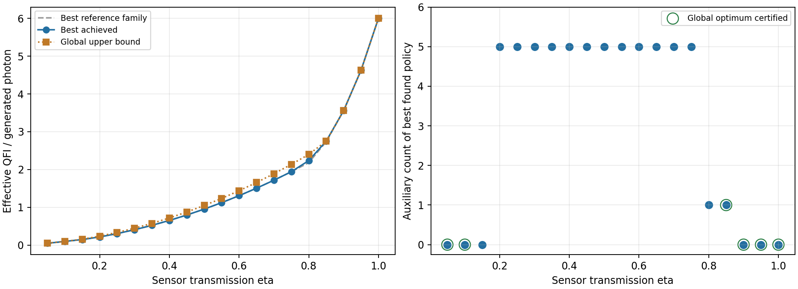
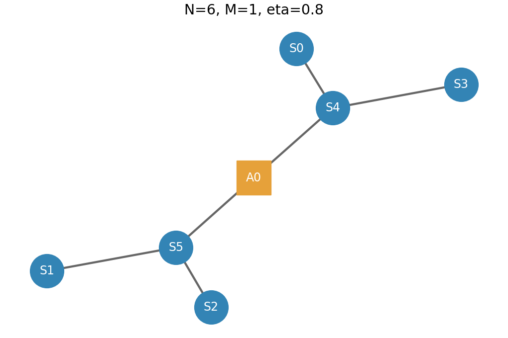
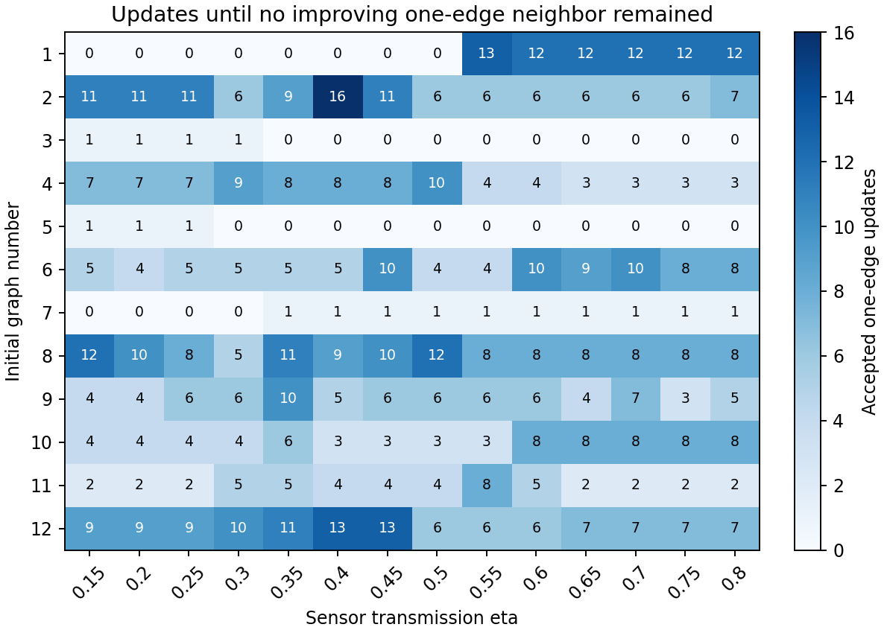

# 6センサ限定：透過率点数を指定できる確定的XYZ探索

対象は6センサのみ、補助M=0〜6。今回は**20点、eta=1/20,2/20,…,1**で実行した。
補助XYZ測定、設定の確率混合なし。グラフ更新回数・測定方針の巡回数に上限を設けず、改善停止まで続ける。

## 設定と再実行

点数は **`--eta-points` の1か所**で指定する。今回の実行コマンド：

```bash
python search.py --eta-points 20
python verify_upper.py
python make_report.py
```

40点なら `python search.py --eta-points 40`（0.025,0.05,…,1）。
初期値数は別引数で、例は `python search.py --eta-points 20 --restarts 24`。
既定の点数はsearch.py冒頭の`DEFAULT_ETA_POINTS=20`。引数が優先する。
検証・図表は保存されたeta_gridから点数を読むため、他ファイルの修正や点数の再指定は不要。
実行結果はresultsを上書きする。初回準備：

```bash
cd deterministic_xyz_N6
python -m venv .venv
source .venv/bin/activate
pip install -r requirements.txt
```

Windowsは仮想環境の有効化方法を変更する。DB入力は同梱済み。

## 結果

|透過率|最良発見補助数|達成値／光子|全候補上界|大域最適性|
|---:|---:|---:|---:|---|
|0.05|0|0.050000|0.050000|保証あり|
|0.1|0|0.100000|0.100000|保証あり|
|0.15|0|0.150000|0.157500|未保証|
|0.2|5|0.218182|0.240000|未保証|
|0.25|5|0.306818|0.337500|未保証|
|0.3|5|0.409091|0.450000|未保証|
|0.35|5|0.525000|0.577500|未保証|
|0.4|5|0.654545|0.720000|未保証|
|0.45|5|0.797727|0.877500|未保証|
|0.5|5|0.954545|1.050000|未保証|
|0.55|5|1.125000|1.237500|未保証|
|0.6|5|1.309091|1.440000|未保証|
|0.65|5|1.506818|1.657500|未保証|
|0.7|5|1.718182|1.890000|未保証|
|0.75|5|1.943182|2.137500|未保証|
|0.8|1|2.237294|2.400000|未保証|
|0.85|1|2.751115|2.751115|保証あり|
|0.9|0|3.557196|3.557196|保証あり|
|0.95|0|4.625459|4.625459|保証あり|
|1|0|6.000000|6.000000|保証あり|

指標はF_eff/(6+M)、生成光子1個当たりの有効QFI。大きいほどよい。
**大域最適性を保証したのは6点（eta=0.05,0.1,0.85,0.9,0.95,1）。残り14点は最良発見値であり未保証。**
評価点間の連続区間の保証はなく、同率の全グラフ・全補助数も未列挙。



eta=0.8では補助1個の構成が参照3構成の最良値2.181818182から2.237293714へ2.54%改善した。大域最適性は表の保証欄による。



センサは0〜5、補助は6〜6。辺は`[[0, 4], [1, 5], [2, 5], [3, 4], [4, 6], [5, 6]]`。方針IDは`620faf8b457ec3e4`。

## 探索範囲

|補助M|評価グラフ数|扱い|
|---:|---:|---|
|0|26|役割付きLC代表を全列挙|
|1|115|同上|
|2|964|同上|
|3|10,946|同上|
|4|8,713|複数初期値から改善停止まで局所探索|
|5|解析的構成|U=6eta+30eta²を達成|
|6|解析的構成|M=5構成に独立補助1個を追加|

合計20,764グラフ。M=0〜3は12,051代表で、非連結も含む。
補助だけの連結成分は削除して補助数を減らす方が資源当たりで有利なので、M全体の比較では除外した。
M=0〜3はセンサ・補助の役割を保つLC同値性と番号交換で整理した代表を全列挙した。
**グラフの全列挙は、各グラフの全確定的方針を完全最適化したという意味ではない。**
M=4は通常の役割付きグラフ同型のみをまとめ、LC重複が残る可能性がある。
全232,691役割付きLC代表に対する単純換算上限でも3.74%で、正確なLC網羅率は未計算。
best_found_by_m.csvは各Mの最良発見値で、各M固定の最適値とは限らない。

## 探索・停止条件

独立センサ、補助なし完全グラフ、補助5個の構成を参照値とする。
各グラフの全XYZ補助基底と63個の非空生存集合から上界を求める。
M=0〜3では上界が全体の最良値を超える候補の確定的方針を座標更新する。
M=4では近傍が全体の最良値に届かない場合も、対象etaで方針を調整してから比較する。

局所探索対象は上界比較から自動選択した14点：0.15,0.2,0.25,0.3,0.35,0.4,0.45,0.5,0.55,0.6,0.65,0.7,0.75,0.8。
初期グラフ12個×対象14点の168経路を実行した。
毎回45種類の1辺反転をすべて試し、最大の改善候補へ移動。改善が1e-10以下なら停止する。
グラフ更新回数は無制限。改善のないときに2辺ランダム反転で続行することはしない。
測定方針は既定2初期値から、全損失条件を1巡して改善がなくなるまで更新。判定はF_effで1e-11、巡回数は無制限。
採用方針は実現可能な正のGHZ型最大相関ブロック。全負符号方針や、相関を意図的に壊す全軸までは総当たりしていない。
探索用の乱数は実験設定の確率混合ではない。同じetaの初期方針seedは点数を変えても同じ。

初期構造は独立、センサ完全グラフ、補助削減構成、星、センサ・補助完全グラフと対応接続、サイクル、
5センサ保護ブロック＋独立センサ、密度を変えた乱数グラフ。seed=20261020。
13初期値以上では追加の乱数グラフを生成する。測定後状態の計算は透過率間でキャッシュして再利用する。

## 局所停止の検証

168経路の終端で計7,560近傍を照合した。受理更新は最小0、最大16。
同じ方針評価器と数値許容誤差で改善する1辺変更がないことを確認した。これは大域最適性ではない。
results/local_convergence.csvに停止理由・更新回数・終端値・最良近傍値、summary.jsonに全経路と終端45近傍のIDを保存。



## 上界と保証

F_eff≤1^T F 1より、各生存集合で全XYZ補助基底・全センサ局所Cliffordに対する1^T Q 1の最大を求め、
損失確率で平均して6+Mで割った量をグラフの上界とする。上界が実際に達成可能とは限らない。
整数の相関支持係数を使い、eta=i/20で有理数として評価する。
M=0〜3は全代表の上界の最大、未探索部分を含むM=4にはU/10、M=5,6にはU/11,U/12を使う。
これらの最大が表の全候補上界。達成方針の平均QFIMも有理数で構築し、連立方程式を解いて値を厳密化する。
上下が一致した点だけを大域最適性保証ありとする。

## モデル

- 単純無向CZグラフ状態。センサのみ独立確率etaで生存し、補助は損失なし。
- 消失は位相付与前。損失位置をセンサを消費せず把握できる理想条件。
- 順序は損失把握→補助XYZ測定→結果依存のセンサ単一量子ビットClifford→未知位相付与。
- 位相は各地点で独立に未知。U_i=exp[-i phi_i (I-Z_i)/2]、目標は全6地点の平均。
- w=ones/6、F_eff=1/(w^T F^+ w)。識別不能なら0。
- 全損失・補助結果を記録し、QFIMを先に確率平均。全センサ損失もゼロ情報の試行として数える。
- 全生成光子6+Mで規格化。辺数、生成成功率、操作誤差、補助損失のコストは含めない。
- QFIMの評価であり、位相付与後の具体的読み出し測定・CFIの最適化ではない。

## 独立検証・操作表

補助数別140行＋全体20行を検証。重複を除く21方針について、
非ゼロ補助結果11,974ケースの部分トレース・測定・物理Clifford後の密度行列を確認した。
最大QFIM誤差2.78e-15。達成値は有理数でも再計算した。
さらに36結果で全局所軸・相対符号を直接列挙し上界と比較。最大誤差1.78e-14。

results/deterministic_policies.json.gzに、方針ID、辺、損失別基底、各補助結果のBorn確率、センサゲートを保存。
センサ0〜5、補助6〜6+M−1。ゲートはsurvivors順、補助結果は補助番号順。
全センサ損失時は情報ゼロとして記録し補助をZ測定する。非空生存集合の結果を詳細保存する。
ゲート積は右から作用。S=diag(1,i)、Sdg=S†。

|C†ZC|C|
|---|---|
|+Z|I|
|−Z|X|
|+X|H|
|−X|HZ|
|+Y|HSdg|
|−Y|HS|

操作表は `python export_policy.py 方針ID --output policy.json` で取り出せる。
test_convergence.pyで、5回の改善を要する例の停止、複数点数の配列長・インスタンス独立性を確認する。

## ファイル・来歴

- best_by_eta.csv：最良達成値・方針ID・全候補上界・保証。
- best_found_by_m.csv：補助数別の最良発見値。
- 最良発見結果と、その再実行コード・検証記録のみを公開する。全候補の分割データは公開しない。
- search.pyは全候補をメモリ内で検証し、最良結果・検証集計のみを保存する。全候補ファイルや分類候補キャッシュは作成しない。verify_export.py単独では保存済みの最良方針を物理的に再検証する。全候補の確認をやり直す場合はsearch.pyから実行する。
- summary.json：実行グリッド、方針、平均QFIM、経路と終端近傍。
- local_convergence.csv：更新回数・停止理由。
- validation.json、upper_validation.json：検証。
- provenance.json：実行引数・開始終了UTC・開始時／公開時ソースSHA-256。
- artifact_manifest.json：最終成果物SHA-256。以上のデータはresults内。ログも同梱。

今回の実行は新規計算で、過去の性能ファイルは読んでいない。分類入力と数式・コードは再利用した。
今回の探索は開始時ソースで完了した。探索後、全候補をファイルに保存しない方式へ変更した。探索アルゴリズム・20点の結果は変更していない。開始時と公開時のソースハッシュ、保存方式の変更をprovenance.jsonに記録した。
時間計測用ベンチマークは実行していない。

## 分類入力の出典

[Lars Eirik Danielsen: Database of Self-Dual Quantum Codes](https://www.codetables.de/larsed/vncorbits/)

L. E. Danielsen and M. G. Parker, “On the classification of all self-dual additive codes over GF(4) of length up to 12,”
Journal of Combinatorial Theory, Series A 113(7), 1351–1367 (2006).
[arXiv:math/0504522](https://arxiv.org/abs/math/0504522)

同梱は1〜9頂点の連結LC代表。非連結とセンサ・補助の役割はコードで構成する。
