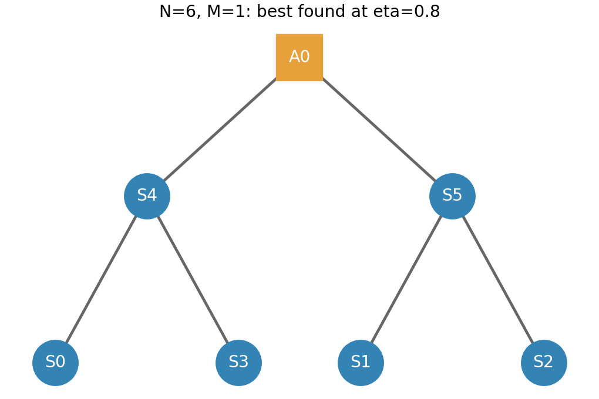

# 6センサ限定：確定的XYZ測定と上界付きグラフ探索

対象は**6センサのみ**。補助M=0〜6、透過率eta=0.1,…,1.0の10点。
設定の確率混合・選択確率の最適化は使わない。7センサ以上は計算していない。

## 結果

|透過率|最良の補助数|達成値／光子|全候補への上界|最適性の保証|
|---:|---:|---:|---:|---|
|0.1|0|0.100000|0.100000|保証あり|
|0.2|5|0.218182|0.240000|未保証|
|0.3|5|0.409091|0.450000|未保証|
|0.4|5|0.654545|0.720000|未保証|
|0.5|5|0.954545|1.050000|未保証|
|0.6|5|1.309091|1.440000|未保証|
|0.7|5|1.718182|1.890000|未保証|
|0.8|1|2.237294|2.400000|未保証|
|0.9|0|3.557196|3.557196|保証あり|
|1.0|0|6.000000|6.000000|保証あり|

評価量は平均位相推定の有効QFIを全生成光子数で割ったF_eff/(6+M)。大きいほどよい。
**0.1・0.9・1.0の3点は大域最適値を保証。その他7点は今回見つかった最良値であり、最適性は未保証。**
透過率の間を結ぶ線は表示用で、連続区間の保証はない。


eta=0.2〜0.7では補助5個の上限達成構成が探索中の最良値だった。
eta=0.8では**補助1個**の別構成が、補助5個の2.181818…から2.237293714…へ2.54%改善した。
「補助0個かN−1個しか有利にならない」という一般則は成立しない。
ただし、この補助1個構成が全グラフで最適だと証明したわけではない。



センサ頂点は0〜5、補助頂点は6。
辺は(0,4),(1,5),(2,5),(3,4),(4,6),(5,6)。
補助A0がセンサS4・S5につながり、S4にS0・S3、S5にS1・S2がつながる木構造。
この構成も消失位置に応じて補助の基底を切り替え、結果に応じて局所Cliffordを行う。
具体的方針IDは`620faf8b457ec3e4`。best_by_eta.csvから方針を参照できる。

## どこまで探索したか

|補助数M|評価したグラフ|網羅性|
|---:|---:|---|
|0|26|役割付きLC代表を全列挙|
|1|115|役割付きLC代表を全列挙|
|2|964|役割付きLC代表を全列挙|
|3|10,946|役割付きLC代表を全列挙|
|4|860|局所探索。通常の役割付きグラフ同型で重複除去|
|5|解析的構成|センサ数固定の上限U=6eta+30eta²を達成|
|6|解析的構成|M=5構成に独立補助を1個追加。情報は同じでコスト増|

最終実行で合計12,911グラフを評価。M=0〜3は12,051代表。
非連結も含み、補助だけの連結成分は、除去して補助数を減らす方が資源当たりで有利なので比較から除外した。
**グラフの全列挙と、各グラフの全確定的測定方針の最適化は別。** M=0〜3でも各M固定の最適達成値をすべて保証したわけではない。

M=4の860候補には通常の同型を超えたLC重複が残る可能性があり、LC代表の網羅率としては扱えない。
全232,691役割付きLC代表に対して0.37%以下の範囲であり、未探索部分が大きい。
best_found_by_m.csvは各補助数の「最良発見値」であって、全てが最適値とは限らない。

## 探索アルゴリズム

1. 独立、補助なし完全グラフ、補助5個の構成を、実現可能な比較基準にする。
2. M=0〜3は公開LC分類に役割を付け、役割を保つLC・番号交換をまとめた全代表を評価する。
3. 各グラフの全3^M補助XYZ基底を扱う。安定化子から63個の非空生存集合に対する上界を求める。
4. 上界が既知の最良達成値を上回る場合に、確定的な損失別方針を座標更新する。
5. M=4は12初期構造・各3ステップ。各ステップで全45種類の1辺反転を試し、改善すれば移動。改善しなければ2辺反転で抜け出す。
6. 初期構造は独立、完全グラフ、補助削減構成、星、サイクル、ブロック積、密度を変えた乱数グラフ。乱数seed=20261020。

グラフ探索中の乱数は候補生成用であり、実験設定の確率混合を導入しない。
測定方針の座標探索は、損失条件ごとに実行可能なQFIMを1つ選び直して、平均QFIMの有効情報量を改善する。
既定では2初期方針・最大3巡。有限回の局所探索なので方針最適化も未保証。

達成値の探索には、各補助基底で実現できる正のGHZ型最大相関ブロックのQFIMを使う。
ブロックを意図的に壊す軸・負の相関を含む全方針は総当たりしていない。
一方、以下の上界は全センサ局所Cliffordを含む。
再利用は安定化子状態ごとの計算キャッシュ。M=4の局所探索に完全なLC正規化や、未評価の損失条件だけを使う途中打ち切りは実装していない。

## 上界と保証範囲

各グラフGについて

\[
B_G(\eta)=\frac{1}{6+M}\sum_{S\ne\varnothing}\eta^{|S|}(1-\eta)^{6-|S|}
\max_{b,C}\mathbf1^TQ_G(S,b,C)\mathbf1
\]

を上界とする。F_eff≤1^T F 1を使っており、一般にB_Gが達成可能とは限らない。
maxの対象は全XYZ補助基底と全センサ局所Clifford。整数の相関支持数を係数として、有理数で評価する。

M=0〜3は全代表のB_Gの最大を取る。未探索M=4についてはU/(6+4)、M=5,6はU/(6+M)を使う。
これらの最大が表の「全候補への上界」。探索済み候補だけの上界ではなく、未探索M=4も含む。
達成値も、方針が固定された後に平均QFIMを有理数で構築し、連立方程式を解いて厳密に計算した。
上下が一致した3点だけを最適性保証ありとする。

eta=0.2〜0.7では真の最適値は今回達成値の1〜1.10倍の範囲にある。
eta=0.8では2.237293714…以上、2.4以下。中間の7点の保証を完成させるには、主にM=4の上界を狭める必要がある。
同率になる全グラフ・全補助数も未列挙。

## モデル

- 単純無向CZグラフ状態。各センサのみ独立確率etaで生存し、補助は損失なし。
- 損失は未知位相の付与前。消費せずに損失位置を把握できる理想条件。
- 順序は損失把握→補助のXYZ測定→結果依存のセンサ局所Clifford→未知位相付与。
- 各地点の位相は独立に未知。U_i=exp[-i phi_i (I-Z_i)/2]、目標は全6地点の平均。
- w=ones/6、F_eff=1/(w^T F^+ w)。識別不能なら0。
- 全損失・補助結果を記録し、QFIMを先に確率平均。全センサ損失もゼロ情報の試行として含める。
- 生成光子数6+Mで規格化。辺数、生成成功率、補助損失、操作誤差のコストは含めない。
- QFIMの評価。位相付与後の具体的読み出し測定・CFIの最適化ではない。

## 独立検証と操作表

全出力の最良方針（補助数別70行＋全体10行、重複を除いて21方針）を密度行列で検証。
部分トレースでセンサ損失を再現し、非ゼロ補助測定結果11785ケースで、物理的Cliffordゲート後のQFIMを確認した。
最大誤差2.89e-15。平均QFIMと達成値も有理数で再計算した。
さらにN=6の任意候補36結果で全3^k局所軸・2^(k-1)相対符号を直接列挙し、安定化子の支持上界と比較した。
最大誤差1.42e-14。

results/deterministic_policies.json.gzに、方針、損失条件ごとの基底、各補助結果の確率、センサCliffordを保存。
頂点0〜5がセンサ、6〜6+M−1が補助。センサゲートはsurvivors順、補助結果は補助番号順。
outcome probabilityはBorn確率で、最適化した設定選択確率ではない。
ゲート積は右から作用し、S=diag(1,i)、Sdg=S†。

|C†ZC|ゲートC|
|---|---|
|+Z|I|
|−Z|X|
|+X|H|
|−X|HZ|
|+Y|HSdg|
|−Y|HS|

全センサ損失時は情報ゼロとして記録し、補助はZ測定。補助結果の詳細表は非空生存集合について保存する。

## 再実行

```bash
cd deterministic_xyz_N6
python -m venv .venv
source .venv/bin/activate
pip install -r requirements.txt
python search.py
python verify_export.py
python verify_upper.py
python make_report.py
```

Windowsは仮想環境の有効化方法を変更する。
search.py --restarts 24 --moves 6で局所探索量を増やせる。実行結果はresultsを上書きする。
操作表を取り出す例：

```bash
python export_policy.py 620faf8b457ec3e4 --output policy_eta08.json
```

search.pyの最終実行は今回の6センサ用の新規計算で、過去の性能ファイルは読み込んでいない。
既存の安定化子計算コードと公開分類入力は再利用した。
開始・終了UTC、実行パラメータ、開始時ソースSHA-256はresults/provenance.json、最終成果物ハッシュはresults/artifact_manifest.json。
探索・検証ログも同梱。時間計測用ベンチマークは実行していない。

## 主なファイル

- results/best_by_eta.csv：透過率別の最良達成値、方針ID、全候補上界、保証の有無。
- results/best_found_by_m.csv：各補助数の最良発見値。各M固定の最適性は未保証。
- results/summary.json：方針、平均QFIM、探索数、保証範囲。
- results/evaluated_graphs.part*.json.gz：評価した12,911グラフ、辺、上界の整数係数、達成値。800候補ずつ分割して保存。検証コードは分割版も直接読み込める。
- results/deterministic_policies.json.gz：全出力の測定・Clifford操作表。
- results/validation.json、upper_validation.json：独立検証。
- search.py、algebra.py、catalogue.py：探索・安定化子・役割付き分類。
- dense_reference.py、verify_export.py、verify_upper.py：密度行列による検証。

## 分類入力の出典

[Lars Eirik Danielsen: Database of Self-Dual Quantum Codes](https://www.codetables.de/larsed/vncorbits/)

L. E. Danielsen and M. G. Parker, “On the classification of all self-dual additive codes over GF(4) of length up to 12,”
Journal of Combinatorial Theory, Series A 113(7), 1351–1367 (2006).
[arXiv:math/0504522](https://arxiv.org/abs/math/0504522)

入力は1〜9頂点の連結LC代表。非連結とセンサ・補助の役割はコードで構成する。
