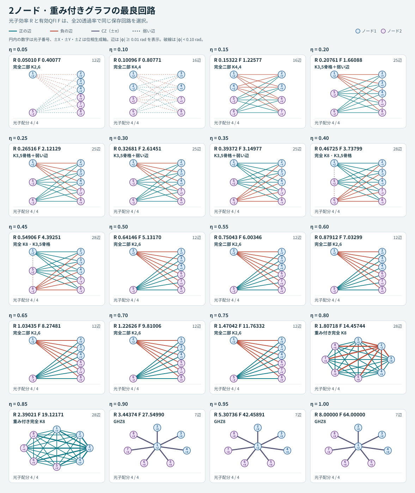
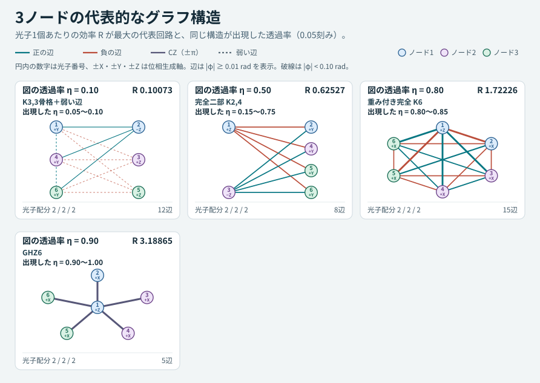
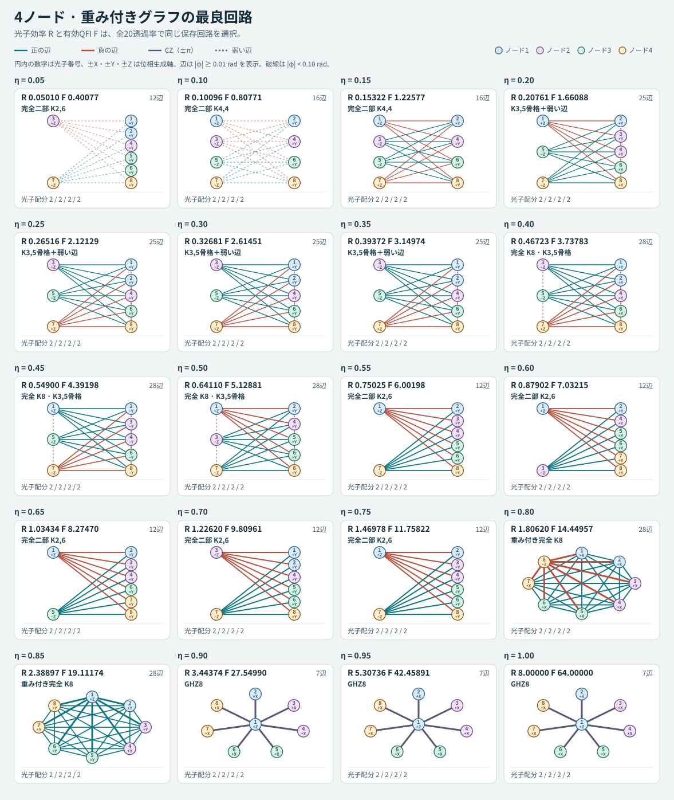
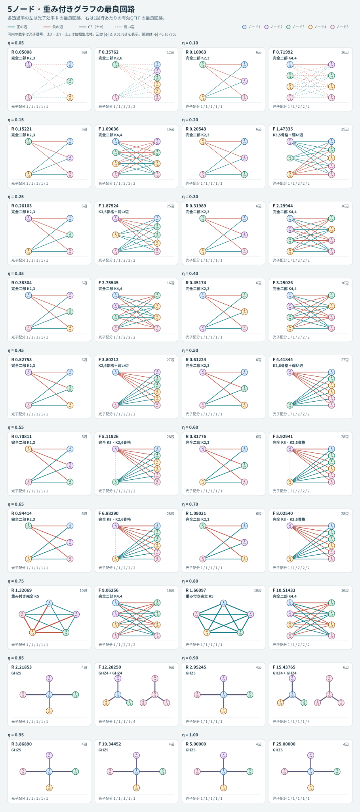
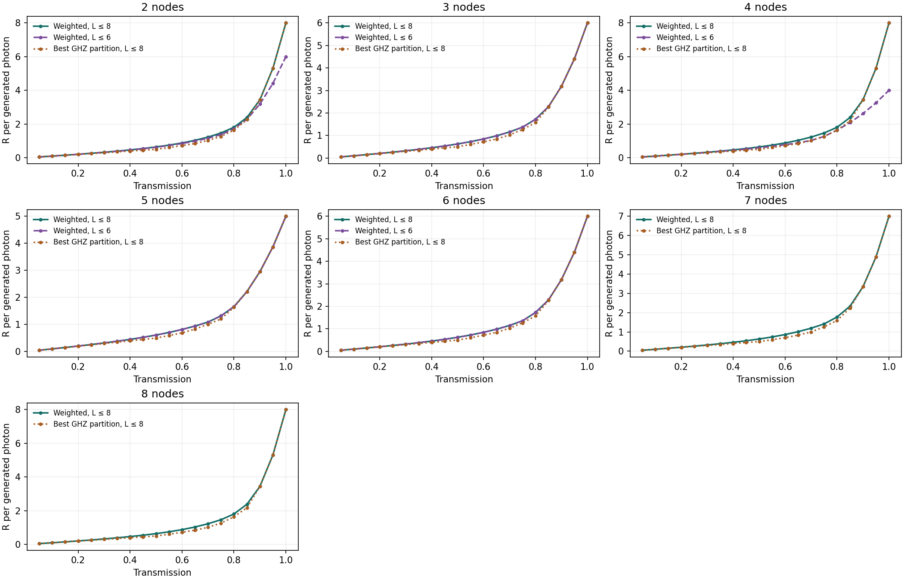
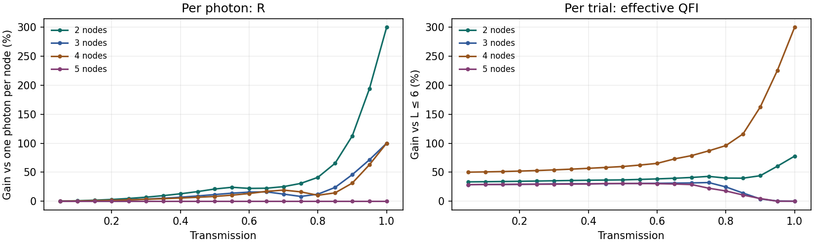
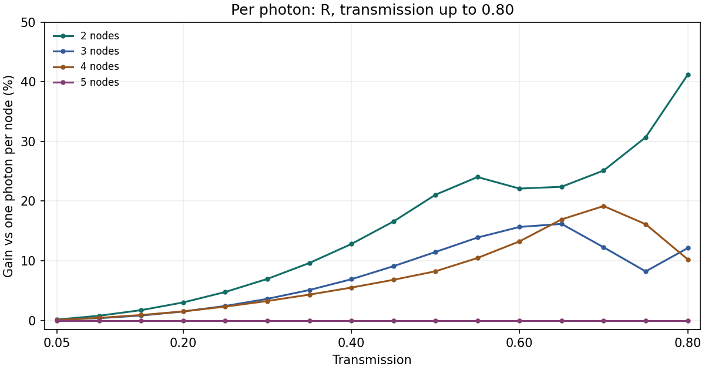

# 2〜5ノード・総8光子までの重み付きグラフ探索

各ノードの独立な未知位相の算術平均を推定する。各ノードに1光子ずつ使う場合から総8光子まで、ノード交換を除いた51配分と透過率 η = 0.05, 0.10, …, 1.00 の20点（計1,020条件）を比較した。

| η = 0.50 | 光子効率 R の最良配分 | 最良 R | 各ノード1光子比 | 有効QFIの最良配分 | 最良有効QFI |
|---:|---|---:|---:|---|---:|
| 2 | (4, 4) | 0.641463 | +21.07% | (4, 4) | 5.131702 |
| 3 | (2, 2, 2) | 0.625271 | +11.47% | (2, 3, 3) | 4.891866 |
| 4 | (2, 2, 2, 2) | 0.641101 | +8.24% | (2, 2, 2, 2) | 5.128811 |
| 5 | (1, 1, 1, 1, 1) | 0.612243 | +0.00% | (1, 1, 2, 2, 2) | 4.418444 |

配分の順序はノードへの光子の送り先を表し、グラフの部とは異なる。η = 0.50 の R 最良回路は、2・3・5ノードでそれぞれ符号付き完全二部 K(2,6)、K(2,4)、K(2,3)。4ノードでは K(3,5) を骨格に部内にも弱い辺を加えた回路が最良だった。η = 0.80 では2〜5ノードとも重み付き完全グラフが R の最良候補だった。

## 光子効率 R が最大の代表構造

各ノード数について、光子1個あたりの効率 `R` が最大になった回路から、構造の異なる代表例を選んだ。各パネルの「出現した η」は、その構造が最良候補に選ばれた透過率をすべて示す。範囲は0.05刻みの計算点をまとめたもの。「図の透過率 η」は、表示した辺の重みと `R` に対応する代表点。`K3,5` 骨格で部内の弱い辺が異なる回路は、同じ構造としてまとめた。

円は光子、円の色は送り先のノードを表す。円内に光子番号と位相生成軸を示した。辺の色で重みの正負とCZを区別し、太い辺ほど角度の絶対値が大きい。図では `|φ| ≥ 0.01 rad` の辺を表示し、`|φ| < 0.10 rad` の辺を破線にした。

### 送り先のノードごとに配置した図

同じセンサに送る光子を一つの枠にまとめた。各図は下の代表構造と同じ回路・透過率を示す。

[2ノード](results/topologies_N2_by_node.svg) · [3ノード](results/topologies_N3_by_node.svg) · [4ノード](results/topologies_N4_by_node.svg) · [5ノード](results/topologies_N5_by_node.svg)

<details>
<summary>2ノードの代表構造</summary>



</details>

<details>
<summary>3ノードの代表構造</summary>



</details>

<details>
<summary>4ノードの代表構造</summary>



</details>

<details>
<summary>5ノードの代表構造</summary>



</details>

## 性能の比較





左図は同じノード数・透過率で、各ノード1光子の最良 `R` を基準にした改善率。右図は総6光子以下での最良有効QFIを基準にした改善率。どちらも比較先は総8光子以下での最良値。



- [ノード数×透過率の比較CSV（80条件）](results/budget_comparison.csv)
- [結果・全回路・再現用データのZIP](results/simulation_archive.zip)：`final.json` に全1,020条件の辺重み、光子ごとの生成軸、ノードQFIM、有効QFI、再計算値を収録。`prior_verified.json` は再利用した2・3ノード・総6光子以下の探索結果。
- 辺重みは光子をノード順に並べたときの `itertools.combinations(range(L), 2)` 順で、単位はrad。

## 探索モデルと検算

- 全光子ペアに連続な制御位相の重みを許す。0は辺なし。生成軸は光子ごとに固定局所クリフォードで選び、同一ノードの生存光子の生成子を足す。
- 独立な消失を仮定し、損失位置を記録した全パターンの混合状態QFIMを確率平均する。平均位相に対して `F_eff = 1 / (wᵀ Qbar⁺ w)`、`w = ones(N)/N`、生成光子あたりの指標は `R = F_eff/L`。識別不能なら情報量は0。
- 重み評価33,229回（既存結果の再利用分を除く）。最終候補190件の全局所クリフォード軸を、固定重みで照合した。全1,020条件の保存回路を損失後密度行列から独立に再計算し、有効QFIの最大差は約1.40×10⁻⁹だった。
- GHZ対照は光子配分・GHZブロック・符号を全列挙した最良値。総8光子までの通常CZグラフ全体の理論上界とはしていない。連続重みは多点初期化を使った有限の数値探索で、報告値は最良発見値。特定測定での達成精度は評価していない。

## 再現方法

このディレクトリで実行する。公開済みデータからHTMLを再生成するには：

```sh
python -m pip install -r requirements.txt
python -c "from zipfile import ZipFile; z=ZipFile('results/simulation_archive.zip'); [z.extract(p) for p in ('prior_verified.json', 'final.json')]"
python report.py
```

探索と検算から再実行する場合は、`prior_verified.json` の展開後に `python expanded.py`、`python finish.py`、`python report.py` の順。探索は `runs/` に配分別の結果を保存し、既存結果を再利用する。条件を変えるときは別の出力先を使う。

[比較元：総6光子までの通常CZ探索](../multiphoton_allocation_N2_3_L6)
