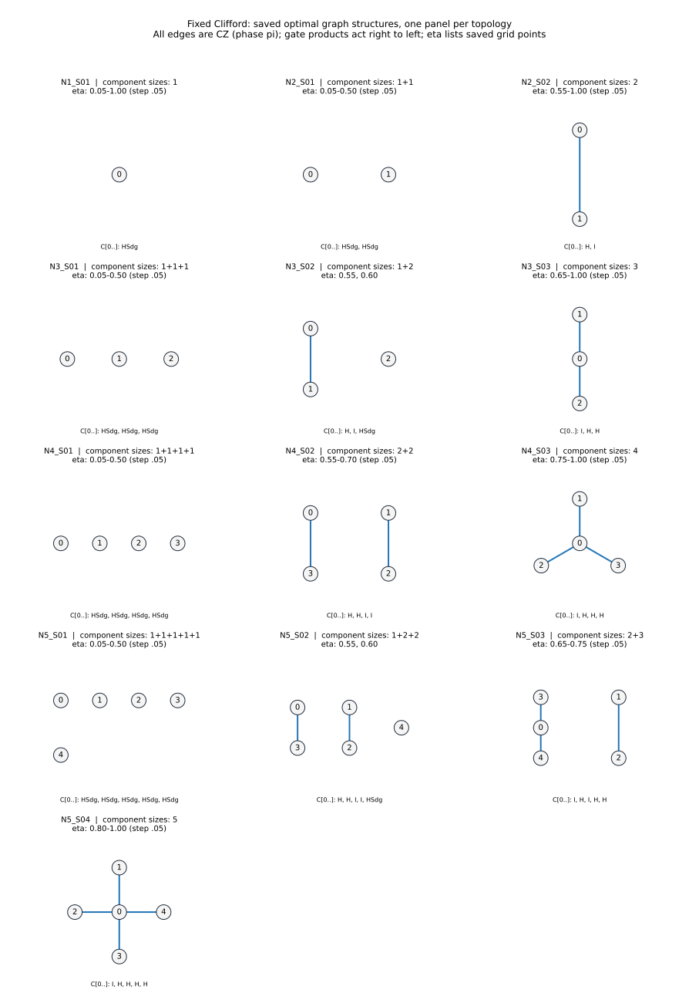

# 固定Clifford：重複を除いた採用グラフ

保存済み100評価点の採用構成を、13種類の接続構造に集約した。

全ての頂点はセンサ。辺はCZ（重みπ）。図の下のゲートは頂点番号順で、積は右から作用する。
同じ頂点数で番号交換により一致する構造をまとめた。Clifford操作が異なる場合も図は重複させず、下表とJSONに全変種を残す。
異なる頂点数・接続構造を、GHZへのLC同値性だけでまとめることはしない。
表示はbest_by_n_eta.csvに保存された代表解のみ。同率最適解の網羅や評価点間の最適性を意味しない。

|構造ID|センサ数|連結成分のサイズ|採用したeta（保存評価点）|図の頂点番号順のゲート|元の構成ID|
|---|---:|---|---|---|---|
|N1_S01|1|1|0.05-1.00 (step .05)|`HSdg`|`N1_g0_pY`|
|N2_S01|2|1+1|0.05-0.50 (step .05)|`HSdg, HSdg`|`N2_g0_pY_pY`|
|N2_S02|2|2|0.55-1.00 (step .05)|`H, I`|`N2_g1_pX_pZ`|
|N3_S01|3|1+1+1|0.05-0.50 (step .05)|`HSdg, HSdg, HSdg`|`N3_g0_pY_pY_pY`|
|N3_S02|3|1+2|0.55, 0.60|`H, I, HSdg`|`N3_g1_pX_pZ_pY`|
|N3_S03|3|3|0.65-1.00 (step .05)|`I, H, H`|`N3_g3_pZ_pX_pX`|
|N4_S01|4|1+1+1+1|0.05-0.50 (step .05)|`HSdg, HSdg, HSdg, HSdg`|`N4_g0_pY_pY_pY_pY`|
|N4_S02|4|2+2|0.55-0.70 (step .05)|`H, H, I, I`|`N4_g12_pX_pX_pZ_pZ`|
|N4_S03|4|4|0.75-1.00 (step .05)|`I, H, H, H`|`N4_g7_pZ_pX_pX_pX`|
|N5_S01|5|1+1+1+1+1|0.05-0.50 (step .05)|`HSdg, HSdg, HSdg, HSdg, HSdg`|`N5_g0_pY_pY_pY_pY_pY`|
|N5_S02|5|1+2+2|0.55, 0.60|`H, H, I, I, HSdg`|`N5_g20_pX_pX_pZ_pZ_pY`|
|N5_S03|5|2+3|0.65-0.75 (step .05)|`I, H, I, H, H`|`N5_g28_pZ_pX_pZ_pX_pX`|
|N5_S04|5|5|0.80-1.00 (step .05)|`I, H, H, H, H`|`N5_g15_pZ_pX_pX_pX_pX`|

[構造・辺・番号対応・正確な性能値のJSON](graph_structures.json)
／ [元の全評価点の数値](best_by_n_eta.csv) ／ [元の構成データ](protocols.json)
