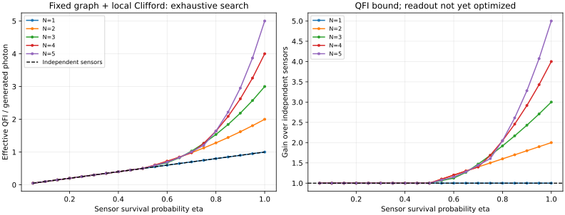

# 固定Clifford・補助なし：探索結果

センサ数1〜5、独立な局所位相の算術平均。全損失試行を含めたQFIMを評価する。
これは読み出し測定を最適化したCFIの実測可能性能ではなく、QFIに基づく上限評価である。

## 探索件数

|N|グラフ代表|回転込み候補|異なるQFIプロファイル|
|---:|---:|---:|---:|
|1|1|6|2|
|2|2|72|7|
|3|3|648|28|
|4|6|7,776|131|
|5|11|85,536|814|

重複プロファイルは、全生存集合に対する符号付きQFIMが一致する場合だけまとめた。
固定したグラフと回転を全試行で使う。損失パターン別の入力最適化、設定の確率混合は行っていない。

## 透過率ごとの最良値

各値は光子当たり有効QFI。独立センサはetaと一致する。

|eta|N=1|N=2|N=3|N=4|N=5|
|---:|---:|---:|---:|---:|---:|
|0.05|0.05000000|0.05000000|0.05000000|0.05000000|0.05000000|
|0.1|0.10000000|0.10000000|0.10000000|0.10000000|0.10000000|
|0.15|0.15000000|0.15000000|0.15000000|0.15000000|0.15000000|
|0.2|0.20000000|0.20000000|0.20000000|0.20000000|0.20000000|
|0.25|0.25000000|0.25000000|0.25000000|0.25000000|0.25000000|
|0.3|0.30000000|0.30000000|0.30000000|0.30000000|0.30000000|
|0.35|0.35000000|0.35000000|0.35000000|0.35000000|0.35000000|
|0.4|0.40000000|0.40000000|0.40000000|0.40000000|0.40000000|
|0.45|0.45000000|0.45000000|0.45000000|0.45000000|0.45000000|
|0.5|0.50000000|0.50000000|0.50000000|0.50000000|0.50000000|
|0.55|0.55000000|0.60500000|0.58548387|0.60500000|0.59313725|
|0.6|0.60000000|0.72000000|0.67500000|0.72000000|0.69230769|
|0.65|0.65000000|0.84500000|0.82387500|0.84500000|0.83219697|
|0.7|0.70000000|0.98000000|1.02900000|0.98000000|1.00882353|
|0.75|0.75000000|1.12500000|1.26562500|1.26562500|1.20535714|
|0.8|0.80000000|1.28000000|1.53600000|1.63840000|1.63840000|
|0.85|0.85000000|1.44500000|1.84237500|2.08802500|2.21852656|
|0.9|0.90000000|1.62000000|2.18700000|2.62440000|2.95245000|
|0.95|0.95000000|1.80500000|2.57212500|3.25802500|3.86890469|
|1|1.00000000|2.00000000|3.00000000|4.00000000|5.00000000|

## 各Nの採用構成が変わる評価点

同率の場合は代表1構成を示す。区間の厳密な切替境界や全同率回路の列挙ではない。
番号は0始まり。HSdgは先にS†、次にHを作用させる。

|N|その構成を最初に採用したeta|辺|センサ0から順のゲート|
|---:|---:|---|---|
|1|0.05|`[]`|`['HSdg']`|
|2|0.05|`[]`|`['HSdg', 'HSdg']`|
|2|0.55|`[[0, 1]]`|`['H', 'I']`|
|3|0.05|`[]`|`['HSdg', 'HSdg', 'HSdg']`|
|3|0.55|`[[0, 1]]`|`['H', 'I', 'HSdg']`|
|3|0.65|`[[0, 1], [0, 2]]`|`['I', 'H', 'H']`|
|4|0.05|`[]`|`['HSdg', 'HSdg', 'HSdg', 'HSdg']`|
|4|0.55|`[[0, 3], [1, 2]]`|`['H', 'H', 'I', 'I']`|
|4|0.75|`[[0, 1], [0, 2], [0, 3]]`|`['I', 'H', 'H', 'H']`|
|5|0.05|`[]`|`['HSdg', 'HSdg', 'HSdg', 'HSdg', 'HSdg']`|
|5|0.55|`[[0, 3], [1, 2]]`|`['H', 'H', 'I', 'I', 'HSdg']`|
|5|0.65|`[[0, 3], [0, 4], [1, 2]]`|`['I', 'H', 'I', 'H', 'H']`|
|5|0.8|`[[0, 1], [0, 2], [0, 3], [0, 4]]`|`['I', 'H', 'H', 'H', 'H']`|

## 範囲と限界

- 全探索の範囲は、全単純無向グラフと固定局所Clifford。任意角度の局所回転は含まない。
- 最適性は指定された透過率点と数値許容誤差の範囲。近接候補は有理数で比較した。
- 指標は平均位相のQCRB。平均が識別不能な場合は有効情報ゼロ。
- 辺の生成コスト、操作誤差、検出器不完全性は含めない。
- センサの読み出し測定基底や、局所測定による達成可能性は未探索。
