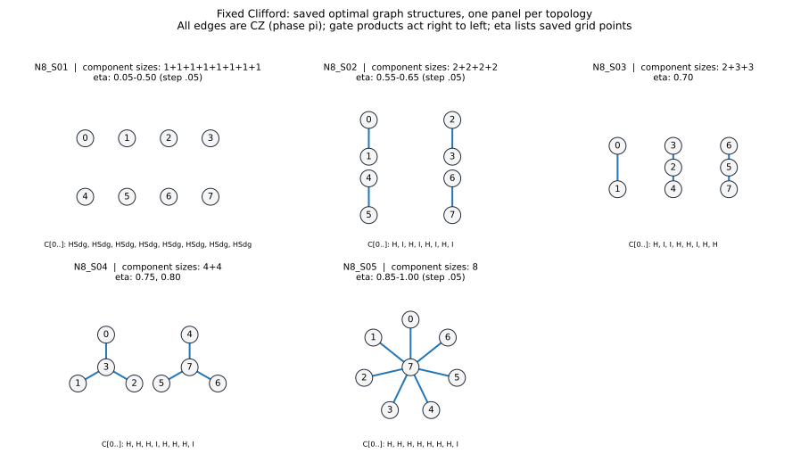

# 固定Clifford：重複を除いた採用グラフ

保存済み20評価点の採用構成を、5種類の接続構造に集約した。

全ての頂点はセンサ。辺はCZ（重みπ）。図の下のゲートは頂点番号順で、積は右から作用する。
同じ頂点数で番号交換により一致する構造をまとめた。Clifford操作が異なる場合も図は重複させず、下表とJSONに全変種を残す。
異なる頂点数・接続構造を、GHZへのLC同値性だけでまとめることはしない。
表示はbest_by_n_eta.csvに保存された代表解のみ。同率最適解の網羅や評価点間の最適性を意味しない。

|構造ID|センサ数|連結成分のサイズ|採用したeta（保存評価点）|図の頂点番号順のゲート|元の構成ID|
|---|---:|---|---|---|---|
|N8_S01|8|1+1+1+1+1+1+1+1|0.05-0.50 (step .05)|`HSdg, HSdg, HSdg, HSdg, HSdg, HSdg, HSdg, HSdg`|`N8_g0_pY_pY_pY_pY_pY_pY_pY_pY`|
|N8_S02|8|2+2+2+2|0.55-0.65 (step .05)|`H, I, H, I, H, I, H, I`|`N8_g59_pX_pZ_pX_pZ_pX_pZ_pX_pZ`|
|N8_S03|8|2+3+3|0.70|`H, I, I, H, H, I, H, H`|`N8_g62_pX_pZ_pZ_pX_pX_pZ_pX_pX`|
|N8_S04|8|4+4|0.75, 0.80|`H, H, H, I, H, H, H, I`|`N8_g78_pX_pX_pX_pZ_pX_pX_pX_pZ`|
|N8_S05|8|8|0.85-1.00 (step .05)|`H, H, H, H, H, H, H, I`|`N8_g81_pX_pX_pX_pX_pX_pX_pX_pZ`|

[構造・辺・番号対応・正確な性能値のJSON](graph_structures.json)
／ [元の全評価点の数値](best_by_n_eta.csv) ／ [元の構成データ](protocols.json)
