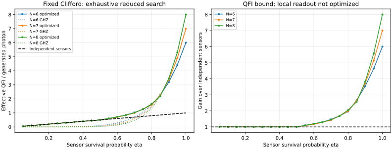

# 8センサ：固定Cliffordの効率的全探索

補助なし、独立な未知位相の算術平均、共通透過率、全損失試行を利用。
結果はQFIMに基づく性能上限であり、実際の局所読み出し測定のCFI最適化ではない。

比較図・比較表の6・7センサ値は、既存の保存結果を使用している。

## 全探索件数

|N|LC代表|符号付き単純列挙|対称性なし・符号決定後|配置対称性で削減後|情報多項式の種類|
|---:|---:|---:|---:|---:|---:|
|8|182|305,690,112|1,010,389|417,105|13,109|

この環境での主探索時間は449.564秒（検証・図作成を除く）。他のPCでの実行時間は保証しない。
配置はすべて評価し、上界による候補の打切りやGHZ状態だけへの候補制限は行っていない。

## 透過率ごとの最良値

倍率は独立センサに対する有効QFI比。分散下限の倍率はその逆数。
構成欄は、同じ最適値を達成するGHZブロックのサイズ。1は独立センサ、2はベル対。

|eta|N=6 情報/光子|倍率|構成|N=7 情報/光子|倍率|構成|N=8 情報/光子|倍率|構成|
|---:|---:|---:|---|---:|---:|---|---:|---:|---|
|0.05|0.05000000|1.000000|1+1+1+1+1+1|0.05000000|1.000000|1+1+1+1+1+1+1|0.05000000|1.000000|1+1+1+1+1+1+1+1|
|0.1|0.10000000|1.000000|1+1+1+1+1+1|0.10000000|1.000000|1+1+1+1+1+1+1|0.10000000|1.000000|1+1+1+1+1+1+1+1|
|0.15|0.15000000|1.000000|1+1+1+1+1+1|0.15000000|1.000000|1+1+1+1+1+1+1|0.15000000|1.000000|1+1+1+1+1+1+1+1|
|0.2|0.20000000|1.000000|1+1+1+1+1+1|0.20000000|1.000000|1+1+1+1+1+1+1|0.20000000|1.000000|1+1+1+1+1+1+1+1|
|0.25|0.25000000|1.000000|1+1+1+1+1+1|0.25000000|1.000000|1+1+1+1+1+1+1|0.25000000|1.000000|1+1+1+1+1+1+1+1|
|0.3|0.30000000|1.000000|1+1+1+1+1+1|0.30000000|1.000000|1+1+1+1+1+1+1|0.30000000|1.000000|1+1+1+1+1+1+1+1|
|0.35|0.35000000|1.000000|1+1+1+1+1+1|0.35000000|1.000000|1+1+1+1+1+1+1|0.35000000|1.000000|1+1+1+1+1+1+1+1|
|0.4|0.40000000|1.000000|1+1+1+1+1+1|0.40000000|1.000000|1+1+1+1+1+1+1|0.40000000|1.000000|1+1+1+1+1+1+1+1|
|0.45|0.45000000|1.000000|1+1+1+1+1+1|0.45000000|1.000000|1+1+1+1+1+1+1|0.45000000|1.000000|1+1+1+1+1+1+1+1|
|0.5|0.50000000|1.000000|1+1+1+1+1+1|0.50000000|1.000000|1+1+1+1+1+1+1|0.50000000|1.000000|1+1+1+1+1+1+1+1|
|0.55|0.60500000|1.100000|2+2+2|0.59647887|1.084507|1+2+2+2|0.60500000|1.100000|2+2+2+2|
|0.6|0.72000000|1.200000|2+2+2|0.70000000|1.166667|1+2+2+2|0.72000000|1.200000|2+2+2+2|
|0.65|0.84500000|1.300000|2+2+2|0.83581522|1.285870|2+2+3|0.84500000|1.300000|2+2+2+2|
|0.7|1.02900000|1.470000|3+3|1.00041667|1.429167|2+2+3|1.01629630|1.451852|2+3+3|
|0.75|1.26562500|1.687500|3+3|1.26562500|1.687500|3+4|1.26562500|1.687500|4+4|
|0.8|1.57286400|1.966080|6|1.59288889|1.991111|3+4|1.63840000|2.048000|4+4|
|0.85|2.26289709|2.662232|6|2.24403962|2.640047|7|2.17992420|2.564617|8|
|0.9|3.18864600|3.542940|6|3.34807830|3.720087|7|3.44373768|3.826375|8|
|0.95|4.41055134|4.642686|6|4.88836107|5.145643|7|5.30736345|5.586698|8|
|1|6.00000000|6.000000|6|7.00000000|7.000000|7|8.00000000|8.000000|8|

全評価点で、探索最良値はGHZブロック直積の最良値と有理数で一致した。
この探索範囲では、それを上回るグラフ状態は見つからなかった。
ブロック活動度の係数上界も全候補で検査した。切替境界の連続的な探索は行っていない。

## 保存した操作表

同じ構成が連続する場合は最初の評価点だけを示す。ゲートはセンサ0から順。積は右から作用。

|N|最初のeta|辺|ゲート|
|---:|---:|---|---|
|8|0.05|`[]`|`['HSdg', 'HSdg', 'HSdg', 'HSdg', 'HSdg', 'HSdg', 'HSdg', 'HSdg']`|
|8|0.55|`[[0, 1], [2, 3], [4, 5], [6, 7]]`|`['H', 'I', 'H', 'I', 'H', 'I', 'H', 'I']`|
|8|0.7|`[[0, 1], [2, 3], [2, 4], [5, 6], [5, 7]]`|`['H', 'I', 'I', 'H', 'H', 'I', 'H', 'H']`|
|8|0.75|`[[0, 3], [1, 3], [2, 3], [4, 7], [5, 7], [6, 7]]`|`['H', 'H', 'H', 'I', 'H', 'H', 'H', 'I']`|
|8|0.85|`[[0, 7], [1, 7], [2, 7], [3, 7], [4, 7], [5, 7], [6, 7]]`|`['H', 'H', 'H', 'H', 'H', 'H', 'H', 'I']`|

## 検証

- 密度行列で検証した採用構成：5。
- 損失パターンの密度行列検算：1280。
- 各損失パターンQFIMの最大差：3.109e-15。
- 生存数集計QFIMの最大差：8.527e-14。
- 不均一・非ゼロの位相での最大差：5.684e-14。
- 全符号を照合した配置数：305,690,112。
- 有理数で確認した保存値：20点。

## 適用範囲

- 固定Clifford入力のみ。任意角度回転、設定の確率混合、補助、損失別の入力変更は含めない。
- 古典基準は、同じ生成光子数・損失確率の独立センサ。
- 辺の生成コスト・操作誤差・検出器不完全性は含めない。
- 具体的な読み出し測定と、そのCFIによる達成可能性は未探索。
- 有理数比較の前に浮動小数点の近接候補選別を使う。任意角度までの大域最適性ではない。
