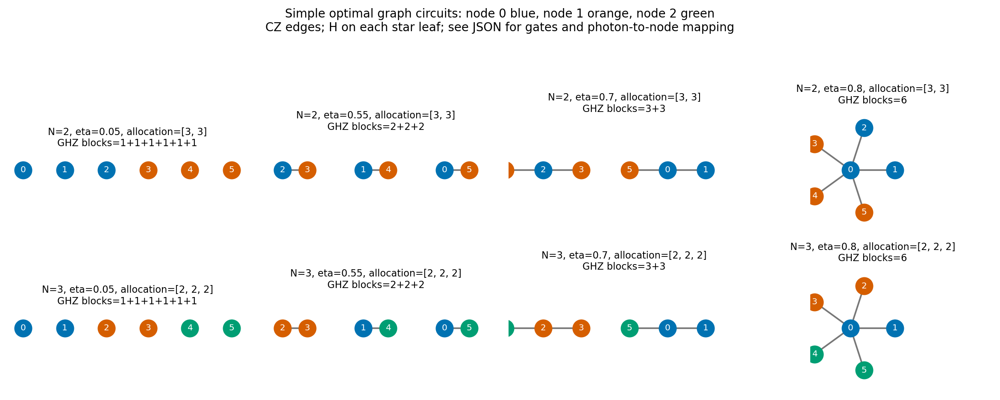

# 総6光子以下：2・3ノードの全配分・全グラフ最適化

各ノードの光子数を固定せず、**合計が6個以下**の全配分を探索した。
通常のCZグラフ状態（辺の重みπ）と、光子ごとの固定局所クリフォードを最適化する。
生存確率η=0.05,0.10,…,1.00の20点で計算した。

**不均等配分で最高値は更新されなかった。**
光子当たり効率でも1回当たり総情報量でも、均等配分が最適値を達成した。
GHZ分割に限定せず全グラフを探索したうえで、各配分の最良値が完全なGHZ上界と一致した。
以下の「最適」はこのモデル・グリッド・通常グラフ＋固定Cliffordの範囲を指す。

## 結果を見る場所

| ファイル | 内容 |
|---|---|
| [results/report.html](results/report.html) | 図と数値をまとめた単独HTML。ダウンロードして開ける |
| [results/best_under_budget.csv](results/best_under_budget.csv) | L≤6で**光子当たり効率R**を最大化した40点。同率の光子数・配分も記録 |
| [results/best_total_QFI_under_budget.csv](results/best_total_QFI_under_budget.csv) | L≤6で**1回当たり有効QFI**を最大化した40点 |
| [results/best_by_allocation_eta.csv](results/best_by_allocation_eta.csv) | 不均等配分を含む16配分×20点、計320点の最良値 |
| [results/best_by_N_L_eta.csv](results/best_by_N_L_eta.csv) | N・総光子数Lごとの最良値、180点 |
| [results/simple_GHZ_graphs.json](results/simple_GHZ_graphs.json) | 同じ最良値を達成する簡単なグラフの辺・ノード割当・クリフォード |
| [results/protocols.json](results/protocols.json) | 全グラフ探索から得た代表回路と、正確なQFIM・生存数別整数係数 |
| [results/validation.json](results/validation.json) | 混合状態SLDによる検算と有理数上界証明値 |



図の色は未知位相のノード、数字は物理光子の番号。全頂点がセンサ光子で、補助はない。
辺はCZ。各GHZ星の葉にHをかける。厳密なゲート列はJSONを参照。
同率の回路を全て保存したものではなく、各条件で代表を一つ保存する。

## 何が最適だったか

**1回当たり総有効QFI**を最大化すると、全40点で6光子を使い、
2ノードでは配分(3,3)、3ノードでは(2,2,2)が最適値を達成した。
この2条件の最良値とGHZサイズ分割は一致した。

| η（計算したグリッド点） | 最適GHZサイズ分割 | 光子当たりR | 総有効QFI |
|---|---|---|---|
| 0.05〜0.50 | 1+1+1+1+1+1 | η | 6η |
| 0.55〜0.65 | 2+2+2 | 2η² | 12η² |
| 0.70〜0.75 | 3+3 | 3η³ | 18η³ |
| 0.80〜1.00 | 6 | 6η⁶ | 36η⁶ |

上の範囲は0.05刻みの点をまとめたもので、切り替わりの連続η値を証明した表ではない。
GHZサイズ分割と、ノードへの光子配分は別のもの。
例えば2ノードのGHZ₃⊗GHZ₃は、一方にノード配分(1,2)、もう一方に(2,1)を持たせられる。
試行ごとの設定をランダム化せず、両ブロックを同じ入力に含めて平均位相を識別する。

**光子当たり効率R**では、6個全てを使わなくても最高値になる場合がある。
同率では最小Lを代表に選んだ結果は次の通り。

| N | η（グリッド点） | 代表の光子配分 | GHZサイズ分割 |
|---|---|---|---|
| 2 | 0.05〜0.50 | (1,1) | 1+1 |
| 2 | 0.55〜0.65 | (1,1) | 2 |
| 2 | 0.70 | (3,3) | 3+3 |
| 2 | 0.75〜0.80 | (2,2) | 4 |
| 2 | 0.85〜1.00 | (3,3) | 6 |
| 3 | 0.05〜0.50 | (1,1,1) | 1+1+1 |
| 3 | 0.55〜0.65 | (2,2,2) | 2+2+2 |
| 3 | 0.70〜0.75 | (1,1,1) | 3 |
| 3 | 0.80〜1.00 | (2,2,2) | 6 |

η=0.75の2ノードでは、4光子と6光子がRで同率。
同率の全Lと全配分は `best_under_budget.csv` の `all_tied_L` と `all_tied_allocations` を参照。
同率配分にも不均等配分は含まれなかった。

例：2ノード・η=0.80の4光子GHZはR=1.6384、総有効QFI=6.5536。
6光子GHZはR=1.572864、総有効QFI=9.437184。
生成光子当たり効率を重視するか、1回の実験の精度を重視するかで選択が変わる。
独立光子の最良効率R=ηに対し、前者は2.048倍、後者は1.96608倍。

## モデルと目的関数

1. L個の光子でCZグラフ状態を生成し、各光子の固定局所Cliffordを適用する。
2. 光子ごとに共通確率ηで独立に生存。失われた光子は部分トレースする。
3. ノードiの生存光子全てに同じ未知位相θᵢをZ/2で付与する。
4. 最終的な生存位置を古典記録に保持する。損失試行も資源に数える。

推定対象は **g=(θ₀+…+θₙ₋₁)/N**。光子数の多いノードを重く数えない。
ノード間の未知位相は独立なパラメータとして扱い、共通位相と仮定しない。
生存位置を事前に知って入力を選び直すことはしない。
偏光非依存消失では固定局所回転と損失の順序は交換できる。

物理光子QFIMをQₚ、光子→ノード割当行列をAとして、各損失分岐で
`Q_node = A.T @ Q_p @ A`。
QFIMを損失確率で先に平均してQ̄を作り、w=ones(N)/Nとする。

```text
F_eff = 1 / (w.T @ Qbar^+ @ w)
R     = F_eff / L
```

wがQ̄の像に入らない場合は平均を識別できず、情報量を0とする。
単にQFIMの対角和や総光子位相の感度を最大化しているのではない。
ν試行の平均位相の局所分散下限は1/(νF_eff)。
これはSLD量子情報の評価であり、指定した局所測定の古典FIの最適化ではない。
補助光子・重み付き辺・任意角度回転・設定の確率混合・生成成功率・ゲート誤差は含めない。

## 探索した配分とグラフ

ノード番号の交換を除いた正の整数配分を全て扱う。光子0個のノードではその独立な
未知位相が情報に入らないため、単純平均を識別できない。この配分は最適化から除ける。

| N | L | 配分（ノード番号交換を除く） |
|---|---|---|
| 2 | 2 | (1,1) |
| 2 | 3 | (1,2) |
| 2 | 4 | (1,3), (2,2) |
| 2 | 5 | (1,4), (2,3) |
| 2 | 6 | (1,5), (2,4), (3,3) |
| 3 | 3 | (1,1,1) |
| 3 | 4 | (1,1,2) |
| 3 | 5 | (1,1,3), (1,2,2) |
| 3 | 6 | (1,1,4), (1,2,3), (2,2,2) |

- L=2,3,4,5,6の全グラフを、LC同値と番号交換の代表2,3,6,11,26個で扱う。
  非連結グラフ・孤立点を含む。これは全グラフを一つずつ番号付きで列挙した数ではない。
- 各グラフに対してクリフォードの有効位相軸±X,±Y,±Zを扱う。
  全光子の一括符号反転だけ同一視する。符号はノード割当後も全て復元する。
- 孤立|+>の有効Xは情報ゼロでZに置換するとQFIMが増加する。
  孤立Y/Zの情報量は同じなので孤立Zに固定する。
- スタビライザーから全損失分岐の**混合状態**QFIMを計算する。
  損失平均後の物理相関ブロックの正確な整数多項式を統合し、全ノード割当・符号を列挙する。
- 光子のN個の非空グループ分けを全列挙する。6光子ではN=2で31通り、N=3で90通り。
  単に配分の整数タプルだけを調べたのではなく、各配分に対応する全光子配置も含める。
- ノードQFIM多項式の一致を使って重複を除く。配分ごとの最大値も残すため、
  異なる配分は同じQFIMでも別候補として保存する。

## 検証と最適性の根拠

全1,078,366個のグループ・符号付き物理多項式候補を生成してから削減した。
GHZの分割だけを初めから探索した結果ではない。

物理相関ブロックbの大きさrと活動度a_b(η)について、全圧縮候補で
`0 <= a_b(η) <= η^r` を整数係数で検査した。
対応するGHZブロックに置換すると、その符号とノード割当のまま、QFIMがPSD順で増加する。
したがって全ての符号付きGHZ分割・全配分を列挙した最大値は、全グラフ候補の上界になる。
**320個の配分×η点で、この上界を有理数で完全評価し、探索の実際の達成値と一致した。**
数値的な最良候補の比較だけで全候補の最適性を主張したものではない。

さらに、グラフゲートと物理Cliffordから状態を作り、損失後の密度行列を部分トレースし、
一般混合状態のSLD式で独立に再計算した。保存した探索最適回路63種類の全2,552マスク、
配分別320点・総光子数別180点を確認。非ゼロ真位相を含む乱数327分岐も確認した。
L≤4では、LC・配置・スタビライザー多項式の削減を使わない番号付き全グラフ・全符号付き軸の探索とも照合。
簡単なGHZ達成回路も、別途、全損失マスクを密度行列から検算する。

保証は今回の**離散ηグリッド**、共通η、通常グラフ＋固定Cliffordクラスについて。
連続η全域・任意量子状態・重み付きグラフ・適応操作に対する最適性ではない。

## 再実行と変更できるパラメータ

Python 3.10以降。依存はnumpy、matplotlib（requirements.txt参照）。

```bash
python -m pip install -r requirements.txt
OPENBLAS_NUM_THREADS=1 OMP_NUM_THREADS=1 python run_search.py
OPENBLAS_NUM_THREADS=1 OMP_NUM_THREADS=1 python verify.py
python make_report.py
# 簡単なGHZ回路の密度行列検算を含める
OPENBLAS_NUM_THREADS=1 OMP_NUM_THREADS=1 python verify.py
python make_report.py
```

```bash
# ノード数、総光子数上限、生存確率を変える
python run_search.py --nodes 3 --max-photons 5 --etas 0.2,0.5,0.7,0.9 --output results_custom
python verify.py --results results_custom
python make_report.py --results results_custom
python verify.py --results results_custom
```

| 引数 | 既定値 | 意味 |
|---|---|---|
| --nodes | 2,3 | 未知位相のノード数。カンマ区切り |
| --max-photons | 6 | 毎試行の総生成光子数の上限。各ノードの上限ではない |
| --eta-min / --eta-max | 0.05 / 1 | 生存確率の範囲 |
| --eta-points | 20 | 端点を含む計算点数 |
| --etas | 未指定 | 小数のカンマ区切り。範囲指定より優先 |
| --output | results | 出力先。同じ出力先の生成ファイルは置換する |
| verify.py: --seed | 20261027 | 密度行列乱数検証の種 |

同梱カタログは総6光子まで。重みを変える変数は今回設けない。
探索対象・数値出力は引数に対応する。説明レポートの結論は保存データから生成する。

## 来歴

既存 `hamaneru25/research` の `fixed_clifford_sensors/engine.py` と
`fixed_clifford_sensors_N6_7/core.py`、LC分類データをvendorに同梱して利用。
今回、光子数上限制約・不均等配分の全配置・配分別探索と有理数証明を追加した。
候補多項式のNPZキャッシュは再実行時に生成し、Gitには含めない。
CSV・回路・物理署名・証明値・コードは保存している。
カタログ入力のハッシュは `vendor/fixed_clifford_sensors_N6_7/data/sources.json`、
配布ファイルのハッシュは `manifest.json`。

分類データ出典：L. E. Danielsen and M. G. Parker,
“On the classification of all self-dual additive codes over GF(4) of length up to 12,”
J. Combin. Theory Ser. A 113, 1351–1367 (2006).
https://www.codetables.de/larsed/vncorbits/
