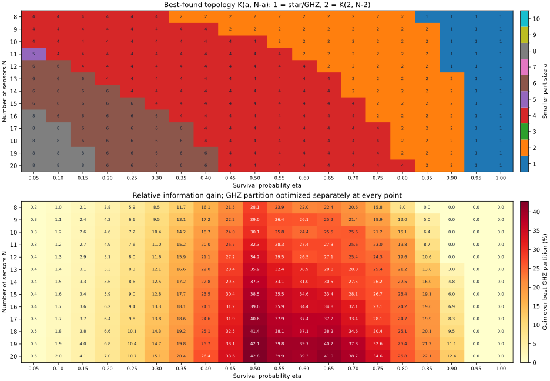
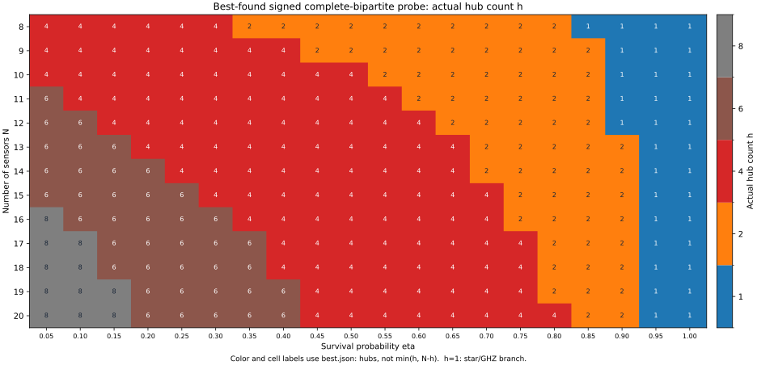
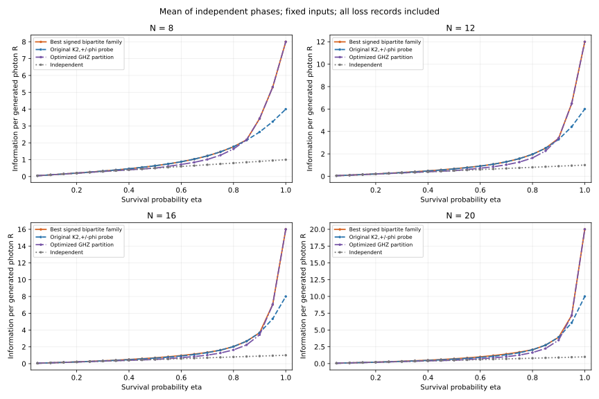

# 8〜20センサ：符号付き完全二部グラフの重み最適化

13センサ数 × 20透過率 = 260条件。表は各評価点での最良発見値であり、連続区間の切替境界や大域最適性を保証しない。

[状態・モデル・再実行方法](../README.md) ／ [計算式と探索条件](../METHODS.md) ／ [CSV](best.csv) ／ [全構成JSON](best.json)

## 構造とGHZ分割に対する改善率

## 実際のハブ数による色分け

色とセル内の数字は `best.json` の `hubs`（符号を割り当てた側のハブ数h）。上の構造図は小さい部の頂点数 `a=min(h,N−h)` なので、両者は異なる場合がある。例えば4ハブ＋3葉ならh=4、a=3。h=1は星型GHZの枝。同じ保存済み260構成の表示を追加したもので、再最適化は行っていない。

## 情報量の比較

青線は元のハブ2個の±φ構成を重み最適化した値。オレンジ線は符号付き完全二部グラフの今回の探索内の最良値。紫線は全整数GHZ分割の最良値。灰色は独立センサ。

## 全センサ数の代表値：透過率0.50

|N|最良構造|R|GHZ分割からの改善率|
|---:|---|---:|---:|
|8|K(2,6)|0.640460502|28.0921%|
|9|K(2,7)|0.644984309|28.9969%|
|10|K(4,6)|0.650351889|30.0704%|
|11|K(4,7)|0.661647411|32.3295%|
|12|K(4,8)|0.671219775|34.2440%|
|13|K(4,9)|0.679413174|35.8826%|
|14|K(4,10)|0.686486624|37.2973%|
|15|K(4,11)|0.692638472|38.5277%|
|16|K(4,12)|0.698022975|39.6046%|
|17|K(4,13)|0.702761761|40.5524%|
|18|K(4,14)|0.706951935|41.3904%|
|19|K(4,15)|0.710671900|42.1344%|
|20|K(4,16)|0.713985624|42.7971%|

各サイズで、評価した20点の最大改善率は透過率0.50だった。高透過率で星型が選ばれる点では通常GHZ状態と同値になる。

## 全260点

`h` は実際のハブ数、`q` は負のハブ数。正のハブは h−q 個。軸の対応と2×2QFIMの順序はREADMEを参照。グラフ名は小さい部を先に表記する。各二部サイズの全ログは `family_N*_a*.json` に保存。

### 8センサ

|η|構造|h|q|φ [rad]|ハブ軸|葉軸|R|最良GHZ R|改善率|
|---:|---|---:|---:|---:|---|---|---:|---:|---:|
|0.05|K(4,4)|4|2|0.048844720|Z|-Y|0.050122299|0.050000000|+0.2446%|
|0.10|K(4,4)|4|2|0.095786466|Z|-Y|0.100963162|0.100000000|+0.9632%|
|0.15|K(4,4)|4|2|0.141357845|Z|-Y|0.153217957|0.150000000|+2.1453%|
|0.20|K(4,4)|4|2|0.185853293|Z|-Y|0.207586478|0.200000000|+3.7932%|
|0.25|K(4,4)|4|2|0.229285003|Z|-Y|0.264791946|0.250000000|+5.9168%|
|0.30|K(4,4)|4|2|0.271429494|Z|-Y|0.325587206|0.300000000|+8.5291%|
|0.35|K(2,6)|2|1|0.406053874|Z|-Y|0.391108340|0.350000000|+11.7452%|
|0.40|K(2,6)|2|1|0.471622939|Z|-Y|0.464378229|0.400000000|+16.0946%|
|0.45|K(2,6)|2|1|0.539275578|Z|-Y|0.546610958|0.450000000|+21.4691%|
|0.50|K(2,6)|2|1|0.609588361|Z|-Y|0.640460502|0.500000000|+28.0921%|
|0.55|K(2,6)|2|1|0.683269809|Z|-Y|0.749480952|0.605000000|+23.8811%|
|0.60|K(2,6)|2|1|0.761015491|Z|-Y|0.878522414|0.720000000|+22.0170%|
|0.65|K(2,6)|2|1|0.843267362|Z|-Y|1.034265094|0.845000000|+22.3982%|
|0.70|K(2,6)|2|1|0.929872699|Z|-Y|1.225865039|1.016296296|+20.6208%|
|0.75|K(2,6)|2|1|1.019826465|Z|-Y|1.465578604|1.265625000|+15.7988%|
|0.80|K(2,6)|2|1|1.111569621|Z|-Y|1.769107813|1.638400000|+7.9778%|
|0.85|K(1,7)|1|0|3.141592654|Z|+X|2.179924200|2.179924200|+0.0000%|
|0.90|K(1,7)|1|0|3.141592654|Z|+X|3.443737680|3.443737680|+0.0000%|
|0.95|K(1,7)|1|0|3.141592654|Z|+X|5.307363450|5.307363450|+0.0000%|
|1.00|K(1,7)|1|0|3.141592654|Z|+X|8.000000000|8.000000000|+0.0000%|

### 9センサ

|η|構造|h|q|φ [rad]|ハブ軸|葉軸|R|最良GHZ R|改善率|
|---:|---|---:|---:|---:|---|---|---:|---:|---:|
|0.05|K(4,5)|4|2|0.048833997|Z|-Y|0.050135909|0.050000000|+0.2718%|
|0.10|K(4,5)|4|2|0.095721568|Z|-Y|0.101070966|0.100000000|+1.0710%|
|0.15|K(4,5)|4|2|0.141171976|Z|-Y|0.153581737|0.150000000|+2.3878%|
|0.20|K(4,5)|4|2|0.185442366|Z|-Y|0.208455952|0.200000000|+4.2280%|
|0.25|K(4,5)|4|2|0.228504371|Z|-Y|0.266516447|0.250000000|+6.6066%|
|0.30|K(4,5)|4|2|0.270122076|Z|-Y|0.328632106|0.300000000|+9.5440%|
|0.35|K(4,5)|4|2|0.309964269|Z|-Y|0.395722196|0.350000000|+13.0635%|
|0.40|K(4,5)|4|2|0.347693406|Z|-Y|0.468759628|0.400000000|+17.1899%|
|0.45|K(2,7)|2|1|0.528478505|Z|-Y|0.549697598|0.450000000|+22.1550%|
|0.50|K(2,7)|2|1|0.595969015|Z|-Y|0.644984309|0.500000000|+28.9969%|
|0.55|K(2,7)|2|1|0.666753025|Z|-Y|0.756114617|0.598351648|+26.3663%|
|0.60|K(2,7)|2|1|0.741687032|Z|-Y|0.888381323|0.704347826|+26.1282%|
|0.65|K(2,7)|2|1|0.821488157|Z|-Y|1.049283775|0.837838983|+25.2369%|
|0.70|K(2,7)|2|1|0.906447975|Z|-Y|1.249518458|1.029000000|+21.4304%|
|0.75|K(2,7)|2|1|0.996136221|Z|-Y|1.504215630|1.265625000|+18.8516%|
|0.80|K(2,7)|2|1|1.089458350|Z|-Y|1.834205319|1.638400000|+11.9510%|
|0.85|K(2,7)|2|1|1.185520761|Z|-Y|2.266813759|2.158566385|+5.0148%|
|0.90|K(1,8)|1|0|3.141592654|Z|+X|3.486784401|3.486784401|+0.0000%|
|0.95|K(1,8)|1|0|3.141592654|Z|+X|5.672244688|5.672244688|+0.0000%|
|1.00|K(1,8)|1|0|3.141592654|Z|+X|9.000000000|9.000000000|+0.0000%|

### 10センサ

|η|構造|h|q|φ [rad]|ハブ軸|葉軸|R|最良GHZ R|改善率|
|---:|---|---:|---:|---:|---|---|---:|---:|---:|
|0.05|K(4,6)|4|2|0.048823242|Z|-Y|0.050146798|0.050000000|+0.2936%|
|0.10|K(4,6)|4|2|0.095656644|Z|-Y|0.101157245|0.100000000|+1.1572%|
|0.15|K(4,6)|4|2|0.140986373|Z|-Y|0.153873171|0.150000000|+2.5821%|
|0.20|K(4,6)|4|2|0.185036245|Z|-Y|0.209153550|0.200000000|+4.5768%|
|0.25|K(4,6)|4|2|0.227747598|Z|-Y|0.267902818|0.250000000|+7.1611%|
|0.30|K(4,6)|4|2|0.268885503|Z|-Y|0.331086677|0.300000000|+10.3622%|
|0.35|K(4,6)|4|2|0.308161745|Z|-Y|0.399743795|0.350000000|+14.2125%|
|0.40|K(4,6)|4|2|0.345310404|Z|-Y|0.474999556|0.400000000|+18.7499%|
|0.45|K(4,6)|4|2|0.380108616|Z|-Y|0.558083836|0.450000000|+24.0186%|
|0.50|K(4,6)|4|2|0.412370350|Z|-Y|0.650351889|0.500000000|+30.0704%|
|0.55|K(2,8)|2|1|0.652174441|Z|-Y|0.760929611|0.605000000|+25.7735%|
|0.60|K(2,8)|2|1|0.724678325|Z|-Y|0.895546982|0.720000000|+24.3815%|
|0.65|K(2,8)|2|1|0.802297628|Z|-Y|1.060290816|0.845000000|+25.4782%|
|0.70|K(2,8)|2|1|0.885662369|Z|-Y|1.267148314|1.008823529|+25.6065%|
|0.75|K(2,8)|2|1|0.974831767|Z|-Y|1.533805295|1.265625000|+21.1896%|
|0.80|K(2,8)|2|1|1.069217084|Z|-Y|1.886038705|1.638400000|+15.1147%|
|0.85|K(2,8)|2|1|1.168150330|Z|-Y|2.360166464|2.218526562|+6.3844%|
|0.90|K(1,9)|1|0|3.141592654|Z|+X|3.486784401|3.486784401|-0.0000%|
|0.95|K(1,9)|1|0|3.141592654|Z|+X|5.987369392|5.987369392|-0.0000%|
|1.00|K(1,9)|1|0|3.141592654|Z|+X|10.000000000|10.000000000|-0.0000%|

### 11センサ

|η|構造|h|q|φ [rad]|ハブ軸|葉軸|R|最良GHZ R|改善率|
|---:|---|---:|---:|---:|---|---|---:|---:|---:|
|0.05|K(5,6)|6|3|0.046622494|Z|-Y|0.050159254|0.050000000|+0.3185%|
|0.10|K(4,7)|4|2|0.095591699|Z|-Y|0.101227828|0.100000000|+1.2278%|
|0.15|K(4,7)|4|2|0.140801094|Z|-Y|0.154111681|0.150000000|+2.7411%|
|0.20|K(4,7)|4|2|0.184634506|Z|-Y|0.209724859|0.200000000|+4.8624%|
|0.25|K(4,7)|4|2|0.227011679|Z|-Y|0.269039420|0.250000000|+7.6158%|
|0.30|K(4,7)|4|2|0.267708337|Z|-Y|0.333102506|0.300000000|+11.0342%|
|0.35|K(4,7)|4|2|0.306482491|Z|-Y|0.403055650|0.350000000|+15.1588%|
|0.40|K(4,7)|4|2|0.343132530|Z|-Y|0.480159288|0.400000000|+20.0398%|
|0.45|K(4,7)|4|2|0.377497154|Z|-Y|0.565823978|0.450000000|+25.7387%|
|0.50|K(4,7)|4|2|0.409436243|Z|-Y|0.661647411|0.500000000|+32.3295%|
|0.55|K(4,7)|4|2|0.438822255|Z|-Y|0.769456685|0.599549550|+28.3391%|
|0.60|K(2,9)|2|1|0.709447233|Z|-Y|0.900757551|0.707142857|+27.3799%|
|0.65|K(2,9)|2|1|0.785106753|Z|-Y|1.068356608|0.839131944|+27.3169%|
|0.70|K(2,9)|2|1|0.866957034|Z|-Y|1.280289595|1.019729730|+25.5519%|
|0.75|K(2,9)|2|1|0.955469928|Z|-Y|1.556475484|1.265625000|+22.9808%|
|0.80|K(2,9)|2|1|1.050552970|Z|-Y|1.927318297|1.609142857|+19.7730%|
|0.85|K(2,9)|2|1|1.151888558|Z|-Y|2.438321319|2.242510633|+8.7318%|
|0.90|K(1,10)|1|0|3.141592654|Z|+X|3.451916557|3.451916557|-0.0000%|
|0.95|K(1,10)|1|0|3.141592654|Z|+X|6.256801015|6.256801015|-0.0000%|
|1.00|K(1,10)|1|0|3.141592654|Z|+X|11.000000000|11.000000000|-0.0000%|

### 12センサ

|η|構造|h|q|φ [rad]|ハブ軸|葉軸|R|最良GHZ R|改善率|
|---:|---|---:|---:|---:|---|---|---:|---:|---:|
|0.05|K(6,6)|6|3|0.046615414|Z|-Y|0.050175222|0.050000000|+0.3504%|
|0.10|K(6,6)|6|3|0.087765759|Z|-Y|0.101327235|0.100000000|+1.3272%|
|0.15|K(4,8)|4|2|0.140616036|Z|-Y|0.154310306|0.150000000|+2.8735%|
|0.20|K(4,8)|4|2|0.184236738|Z|-Y|0.210200659|0.200000000|+5.1003%|
|0.25|K(4,8)|4|2|0.226293987|Z|-Y|0.269986334|0.250000000|+7.9945%|
|0.30|K(4,8)|4|2|0.266581215|Z|-Y|0.334783525|0.300000000|+11.5945%|
|0.35|K(4,8)|4|2|0.304903817|Z|-Y|0.405822845|0.350000000|+15.9494%|
|0.40|K(4,8)|4|2|0.341117895|Z|-Y|0.484484450|0.400000000|+21.1211%|
|0.45|K(4,8)|4|2|0.375112954|Z|-Y|0.572342679|0.450000000|+27.1873%|
|0.50|K(4,8)|4|2|0.406783745|Z|-Y|0.671219775|0.500000000|+34.2440%|
|0.55|K(4,8)|4|2|0.436020461|Z|-Y|0.783249788|0.605000000|+29.4628%|
|0.60|K(4,8)|4|2|0.462721292|Z|-Y|0.910955817|0.720000000|+26.5216%|
|0.65|K(2,10)|2|1|0.769507585|Z|-Y|1.074220809|0.845000000|+27.1267%|
|0.70|K(2,10)|2|1|0.849931138|Z|-Y|1.290026484|1.029000000|+25.3670%|
|0.75|K(2,10)|2|1|0.937716188|Z|-Y|1.573782834|1.265625000|+24.3483%|
|0.80|K(2,10)|2|1|1.033235892|Z|-Y|1.960134760|1.638400000|+19.6371%|
|0.85|K(2,10)|2|1|1.136591903|Z|-Y|2.503679317|2.262897094|+10.6404%|
|0.90|K(1,11)|1|0|3.141592654|Z|+X|3.389154438|3.389154438|+0.0000%|
|0.95|K(1,11)|1|0|3.141592654|Z|+X|6.484321052|6.484321052|+0.0000%|
|1.00|K(1,11)|1|0|3.141592654|Z|+X|12.000000000|12.000000000|+0.0000%|

### 13センサ

|η|構造|h|q|φ [rad]|ハブ軸|葉軸|R|最良GHZ R|改善率|
|---:|---|---:|---:|---:|---|---|---:|---:|---:|
|0.05|K(6,7)|6|3|0.046608402|Z|-Y|0.050188737|0.050000000|+0.3775%|
|0.10|K(6,7)|6|3|0.087737724|Z|-Y|0.101430569|0.100000000|+1.4306%|
|0.15|K(6,7)|6|3|0.124797133|Z|-Y|0.154624412|0.150000000|+3.0829%|
|0.20|K(4,9)|4|2|0.183842615|Z|-Y|0.210602483|0.200000000|+5.3012%|
|0.25|K(4,9)|4|2|0.225592315|Z|-Y|0.270785833|0.250000000|+8.3143%|
|0.30|K(4,9)|4|2|0.265496673|Z|-Y|0.336203348|0.300000000|+12.0678%|
|0.35|K(4,9)|4|2|0.303407786|Z|-Y|0.408163200|0.350000000|+16.6181%|
|0.40|K(4,9)|4|2|0.339234146|Z|-Y|0.488151934|0.400000000|+22.0380%|
|0.45|K(4,9)|4|2|0.372908123|Z|-Y|0.577892174|0.450000000|+28.4205%|
|0.50|K(4,9)|4|2|0.404352125|Z|-Y|0.679413174|0.500000000|+35.8826%|
|0.55|K(4,9)|4|2|0.433468552|Z|-Y|0.795137420|0.600381679|+32.4387%|
|0.60|K(4,9)|4|2|0.460155633|Z|-Y|0.927989854|0.709090909|+30.8704%|
|0.65|K(4,9)|4|2|0.484335075|Z|-Y|1.081537962|0.840029412|+28.7500%|
|0.70|K(2,11)|2|1|0.834290283|Z|-Y|1.297142065|1.013409091|+27.9979%|
|0.75|K(2,11)|2|1|0.921314185|Z|-Y|1.586884308|1.265625000|+25.3835%|
|0.80|K(2,11)|2|1|1.017081658|Z|-Y|1.986113866|1.638400000|+21.2228%|
|0.85|K(2,11)|2|1|1.122145912|Z|-Y|2.558230022|2.252703864|+13.5626%|
|0.90|K(2,11)|2|1|1.237463736|Z|-Y|3.404753118|3.304425577|+3.0362%|
|0.95|K(1,12)|1|0|3.141592654|Z|+X|6.673447083|6.673447083|-0.0000%|
|1.00|K(1,12)|1|0|3.141592654|Z|+X|13.000000000|13.000000000|-0.0000%|

### 14センサ

|η|構造|h|q|φ [rad]|ハブ軸|葉軸|R|最良GHZ R|改善率|
|---:|---|---:|---:|---:|---|---|---:|---:|---:|
|0.05|K(6,8)|6|3|0.046601311|Z|-Y|0.050200324|0.050000000|+0.4006%|
|0.10|K(6,8)|6|3|0.087709465|Z|-Y|0.101519248|0.100000000|+1.5192%|
|0.15|K(6,8)|6|3|0.124736572|Z|-Y|0.154915724|0.150000000|+3.2771%|
|0.20|K(6,8)|6|3|0.158368158|Z|-Y|0.211266399|0.200000000|+5.6332%|
|0.25|K(4,10)|4|2|0.224904792|Z|-Y|0.271468518|0.250000000|+8.5874%|
|0.30|K(4,10)|4|2|0.264448194|Z|-Y|0.337415554|0.300000000|+12.4719%|
|0.35|K(4,10)|4|2|0.301979961|Z|-Y|0.410163005|0.350000000|+17.1894%|
|0.40|K(4,10)|4|2|0.337455840|Z|-Y|0.491292237|0.400000000|+22.8231%|
|0.45|K(4,10)|4|2|0.370845423|Z|-Y|0.582660205|0.450000000|+29.4800%|
|0.50|K(4,10)|4|2|0.402094138|Z|-Y|0.686486624|0.500000000|+37.2973%|
|0.55|K(4,10)|4|2|0.431113453|Z|-Y|0.805463709|0.605000000|+33.1345%|
|0.60|K(4,10)|4|2|0.457799035|Z|-Y|0.942899118|0.720000000|+30.9582%|
|0.65|K(4,10)|4|2|0.482063673|Z|-Y|1.102906657|0.845000000|+30.5215%|
|0.70|K(2,12)|2|1|0.819813262|Z|-Y|1.302213324|1.021702128|+27.4553%|
|0.75|K(2,12)|2|1|0.906064435|Z|-Y|1.596652743|1.265625000|+26.1553%|
|0.80|K(2,12)|2|1|1.001940819|Z|-Y|2.006530501|1.638400000|+22.4689%|
|0.85|K(2,12)|2|1|1.108456701|Z|-Y|2.603625844|2.244039618|+16.0241%|
|0.90|K(2,12)|2|1|1.226854815|Z|-Y|3.509069284|3.348078300|+4.8085%|
|0.95|K(1,13)|1|0|3.141592654|Z|+X|6.827449708|6.827449708|-0.0000%|
|1.00|K(1,13)|1|0|3.141592654|Z|+X|14.000000000|14.000000000|-0.0000%|

### 15センサ

|η|構造|h|q|φ [rad]|ハブ軸|葉軸|R|最良GHZ R|改善率|
|---:|---|---:|---:|---:|---|---|---:|---:|---:|
|0.05|K(6,9)|6|3|0.046594239|Z|-Y|0.050210366|0.050000000|+0.4207%|
|0.10|K(6,9)|6|3|0.087680983|Z|-Y|0.101596172|0.100000000|+1.5962%|
|0.15|K(6,9)|6|3|0.124675091|Z|-Y|0.155168812|0.150000000|+3.4459%|
|0.20|K(6,9)|6|3|0.158250112|Z|-Y|0.211859136|0.200000000|+5.9296%|
|0.25|K(6,9)|6|3|0.188633483|Z|-Y|0.272566914|0.250000000|+9.0268%|
|0.30|K(4,11)|4|2|0.263430552|Z|-Y|0.338460053|0.300000000|+12.8200%|
|0.35|K(4,11)|4|2|0.300608610|Z|-Y|0.411886860|0.350000000|+17.6820%|
|0.40|K(4,11)|4|2|0.335762742|Z|-Y|0.494003649|0.400000000|+23.5009%|
|0.45|K(4,11)|4|2|0.368895444|Z|-Y|0.586789226|0.450000000|+30.3976%|
|0.50|K(4,11)|4|2|0.399972437|Z|-Y|0.692638472|0.500000000|+38.5277%|
|0.55|K(4,11)|4|2|0.428912822|Z|-Y|0.814495245|0.600993377|+35.5248%|
|0.60|K(4,11)|4|2|0.455608431|Z|-Y|0.956029869|0.710526316|+34.5524%|
|0.65|K(4,11)|4|2|0.479960661|Z|-Y|1.121883325|0.840688776|+33.4481%|
|0.70|K(4,11)|4|2|0.501913698|Z|-Y|1.318004395|1.029000000|+28.0859%|
|0.75|K(2,13)|2|1|0.891809455|Z|-Y|1.603755802|1.265625000|+26.7165%|
|0.80|K(2,13)|2|1|0.987690811|Z|-Y|2.022392817|1.638400000|+23.4371%|
|0.85|K(2,13)|2|1|1.095445799|Z|-Y|2.641242935|2.218526562|+19.0539%|
|0.90|K(2,13)|2|1|1.216673185|Z|-Y|3.601264632|3.398425342|+5.9686%|
|0.95|K(1,14)|1|0|3.141592654|Z|+X|6.949368452|6.949368452|+0.0000%|
|1.00|K(1,14)|1|0|3.141592654|Z|+X|15.000000000|15.000000000|+0.0000%|

### 16センサ

|η|構造|h|q|φ [rad]|ハブ軸|葉軸|R|最良GHZ R|改善率|
|---:|---|---:|---:|---:|---|---|---:|---:|---:|
|0.05|K(8,8)|8|4|0.044585147|Z|-Y|0.050223610|0.050000000|+0.4472%|
|0.10|K(6,10)|6|3|0.087652283|Z|-Y|0.101663523|0.100000000|+1.6635%|
|0.15|K(6,10)|6|3|0.124612706|Z|-Y|0.155390685|0.150000000|+3.5938%|
|0.20|K(6,10)|6|3|0.158131156|Z|-Y|0.212379647|0.200000000|+6.1898%|
|0.25|K(6,10)|6|3|0.188429013|Z|-Y|0.273583754|0.250000000|+9.4335%|
|0.30|K(6,10)|6|3|0.215585517|Z|-Y|0.339956729|0.300000000|+13.3189%|
|0.35|K(4,12)|4|2|0.299284154|Z|-Y|0.413384068|0.350000000|+18.1097%|
|0.40|K(4,12)|4|2|0.334138536|Z|-Y|0.496361550|0.400000000|+24.0904%|
|0.45|K(4,12)|4|2|0.367034705|Z|-Y|0.590389162|0.450000000|+31.1976%|
|0.50|K(4,12)|4|2|0.397957151|Z|-Y|0.698022975|0.500000000|+39.6046%|
|0.55|K(4,12)|4|2|0.426832447|Z|-Y|0.822441406|0.605000000|+35.9407%|
|0.60|K(4,12)|4|2|0.453548413|Z|-Y|0.967657494|0.720000000|+34.3969%|
|0.65|K(4,12)|4|2|0.477993283|Z|-Y|1.138818117|0.845000000|+34.7714%|
|0.70|K(4,12)|4|2|0.500096534|Z|-Y|1.342631028|1.016296296|+32.1102%|
|0.75|K(2,14)|2|1|0.878423209|Z|-Y|1.608710726|1.265625000|+27.1080%|
|0.80|K(2,14)|2|1|0.974230014|Z|-Y|2.034504609|1.638400000|+24.1763%|
|0.85|K(2,14)|2|1|1.083046672|Z|-Y|2.672230904|2.234960093|+19.5650%|
|0.90|K(2,14)|2|1|1.206877699|Z|-Y|3.682604374|3.443737680|+6.9363%|
|0.95|K(1,15)|1|0|3.141592654|Z|+X|7.042026698|7.042026698|+0.0000%|
|1.00|K(1,15)|1|0|3.141592654|Z|+X|16.000000000|16.000000000|+0.0000%|

### 17センサ

|η|構造|h|q|φ [rad]|ハブ軸|葉軸|R|最良GHZ R|改善率|
|---:|---|---:|---:|---:|---|---|---:|---:|---:|
|0.05|K(8,9)|8|4|0.044580817|Z|-Y|0.050236815|0.050000000|+0.4736%|
|0.10|K(8,9)|8|4|0.080988958|Z|-Y|0.101734365|0.100000000|+1.7344%|
|0.15|K(6,11)|6|3|0.124549429|Z|-Y|0.155586734|0.150000000|+3.7245%|
|0.20|K(6,11)|6|3|0.158011241|Z|-Y|0.212840220|0.200000000|+6.4201%|
|0.25|K(6,11)|6|3|0.188226398|Z|-Y|0.274485063|0.250000000|+9.7940%|
|0.30|K(6,11)|6|3|0.215284070|Z|-Y|0.341531855|0.300000000|+13.8440%|
|0.35|K(6,11)|6|3|0.239291210|Z|-Y|0.415028398|0.350000000|+18.5795%|
|0.40|K(4,13)|4|2|0.332570036|Z|-Y|0.498424682|0.400000000|+24.6062%|
|0.45|K(4,13)|4|2|0.365244324|Z|-Y|0.593546122|0.450000000|+31.8991%|
|0.50|K(4,13)|4|2|0.396024225|Z|-Y|0.702761761|0.500000000|+40.5524%|
|0.55|K(4,13)|4|2|0.424844495|Z|-Y|0.829468683|0.601461988|+37.9087%|
|0.60|K(4,13)|4|2|0.451589660|Z|-Y|0.978003356|0.711627907|+37.4318%|
|0.65|K(4,13)|4|2|0.476133769|Z|-Y|1.153996475|0.841193694|+37.1856%|
|0.70|K(4,13)|4|2|0.498387925|Z|-Y|1.364893320|1.022982456|+33.4229%|
|0.75|K(4,13)|4|2|0.518325595|Z|-Y|1.620710848|1.265625000|+28.0562%|
|0.80|K(2,15)|2|1|0.961473746|Z|-Y|2.043511821|1.638400000|+24.7261%|
|0.85|K(2,15)|2|1|1.071202294|Z|-Y|2.697553279|2.249663777|+19.9092%|
|0.90|K(2,15)|2|1|1.197433883|Z|-Y|3.754215964|3.466393849|+8.3032%|
|0.95|K(1,16)|1|0|3.141592654|Z|+X|7.108045699|7.108045699|+0.0000%|
|1.00|K(1,16)|1|0|3.141592654|Z|+X|17.000000000|17.000000000|+0.0000%|

### 18センサ

|η|構造|h|q|φ [rad]|ハブ軸|葉軸|R|最良GHZ R|改善率|
|---:|---|---:|---:|---:|---|---|---:|---:|---:|
|0.05|K(8,10)|8|4|0.044576453|Z|-Y|0.050248555|0.050000000|+0.4971%|
|0.10|K(8,10)|8|4|0.080981152|Z|-Y|0.101821497|0.100000000|+1.8215%|
|0.15|K(6,12)|6|3|0.124485272|Z|-Y|0.155761178|0.150000000|+3.8408%|
|0.20|K(6,12)|6|3|0.157890322|Z|-Y|0.213250501|0.200000000|+6.6253%|
|0.25|K(6,12)|6|3|0.188025212|Z|-Y|0.275289119|0.250000000|+10.1156%|
|0.30|K(6,12)|6|3|0.214990167|Z|-Y|0.342939670|0.300000000|+14.3132%|
|0.35|K(6,12)|6|3|0.238907397|Z|-Y|0.417314800|0.350000000|+19.2328%|
|0.40|K(4,14)|4|2|0.331046514|Z|-Y|0.500239468|0.400000000|+25.0599%|
|0.45|K(4,14)|4|2|0.363509069|Z|-Y|0.596328461|0.450000000|+32.5174%|
|0.50|K(4,14)|4|2|0.394154233|Z|-Y|0.706951935|0.500000000|+41.3904%|
|0.55|K(4,14)|4|2|0.422926253|Z|-Y|0.835710962|0.605000000|+38.1340%|
|0.60|K(4,14)|4|2|0.449707818|Z|-Y|0.987247152|0.720000000|+37.1177%|
|0.65|K(4,14)|4|2|0.474358490|Z|-Y|1.167652988|0.845000000|+38.1838%|
|0.70|K(4,14)|4|2|0.496767720|Z|-Y|1.385087311|1.029000000|+34.6052%|
|0.75|K(4,14)|4|2|0.516893735|Z|-Y|1.650700681|1.265625000|+30.4257%|
|0.80|K(2,16)|2|1|0.949350567|Z|-Y|2.049937464|1.638400000|+25.1183%|
|0.85|K(2,16)|2|1|1.059863358|Z|-Y|2.718020415|2.262897094|+20.1124%|
|0.90|K(2,16)|2|1|1.188312252|Z|-Y|3.817104186|3.486784401|+9.4735%|
|0.95|K(1,17)|1|0|3.141592654|Z|+X|7.149857732|7.149857732|+0.0000%|
|1.00|K(1,17)|1|0|3.141592654|Z|+X|18.000000000|18.000000000|+0.0000%|

### 19センサ

|η|構造|h|q|φ [rad]|ハブ軸|葉軸|R|最良GHZ R|改善率|
|---:|---|---:|---:|---:|---|---|---:|---:|---:|
|0.05|K(8,11)|8|4|0.044572091|Z|-Y|0.050259062|0.050000000|+0.5181%|
|0.10|K(8,11)|8|4|0.080973094|Z|-Y|0.101899568|0.100000000|+1.8996%|
|0.15|K(8,11)|8|4|0.111760218|Z|-Y|0.155979374|0.150000000|+3.9862%|
|0.20|K(6,13)|6|3|0.157768358|Z|-Y|0.213618171|0.200000000|+6.8091%|
|0.25|K(6,13)|6|3|0.187825070|Z|-Y|0.276010536|0.250000000|+10.4042%|
|0.30|K(6,13)|6|3|0.214702644|Z|-Y|0.344204856|0.300000000|+14.7350%|
|0.35|K(6,13)|6|3|0.238537811|Z|-Y|0.419374008|0.350000000|+19.8211%|
|0.40|K(6,13)|6|3|0.259510365|Z|-Y|0.502799327|0.400000000|+25.6998%|
|0.45|K(4,15)|4|2|0.361816657|Z|-Y|0.598791103|0.450000000|+33.0647%|
|0.50|K(4,15)|4|2|0.392331515|Z|-Y|0.710671900|0.500000000|+42.1344%|
|0.55|K(4,15)|4|2|0.421059261|Z|-Y|0.841277022|0.601832461|+39.7859%|
|0.60|K(4,15)|4|2|0.447882645|Z|-Y|0.995536074|0.712500000|+39.7244%|
|0.65|K(4,15)|4|2|0.472647302|Z|-Y|1.179981907|0.841592742|+40.2082%|
|0.70|K(4,15)|4|2|0.495218243|Z|-Y|1.403461718|1.018281250|+37.8265%|
|0.75|K(4,15)|4|2|0.515532885|Z|-Y|1.678236779|1.265625000|+32.6014%|
|0.80|K(2,17)|2|1|0.937799876|Z|-Y|2.054208014|1.638400000|+25.3789%|
|0.85|K(2,17)|2|1|1.048986955|Z|-Y|2.734316238|2.255912843|+21.2066%|
|0.90|K(2,17)|2|1|1.179487531|Z|-Y|3.872164729|3.486784401|+11.0526%|
|0.95|K(1,18)|1|0|3.141592654|Z|+X|7.169718448|7.169718448|+0.0000%|
|1.00|K(1,18)|1|0|3.141592654|Z|+X|19.000000000|19.000000000|+0.0000%|

### 20センサ

|η|構造|h|q|φ [rad]|ハブ軸|葉軸|R|最良GHZ R|改善率|
|---:|---|---:|---:|---:|---|---|---:|---:|---:|
|0.05|K(8,12)|8|4|0.044567696|Z|-Y|0.050268520|0.050000000|+0.5370%|
|0.10|K(8,12)|8|4|0.080964785|Z|-Y|0.101969918|0.100000000|+1.9699%|
|0.15|K(8,12)|8|4|0.111753340|Z|-Y|0.156205776|0.150000000|+4.1372%|
|0.20|K(6,14)|6|3|0.157645313|Z|-Y|0.213949419|0.200000000|+6.9747%|
|0.25|K(6,14)|6|3|0.187625627|Z|-Y|0.276661137|0.250000000|+10.6645%|
|0.30|K(6,14)|6|3|0.214420318|Z|-Y|0.345347467|0.300000000|+15.1158%|
|0.35|K(6,14)|6|3|0.238180179|Z|-Y|0.421237327|0.350000000|+20.3535%|
|0.40|K(6,14)|6|3|0.259093305|Z|-Y|0.505685314|0.400000000|+26.4213%|
|0.45|K(4,16)|4|2|0.360157221|Z|-Y|0.600978665|0.450000000|+33.5508%|
|0.50|K(4,16)|4|2|0.390543519|Z|-Y|0.713985624|0.500000000|+42.7971%|
|0.55|K(4,16)|4|2|0.419228549|Z|-Y|0.846256097|0.605000000|+39.8770%|
|0.60|K(4,16)|4|2|0.446097496|Z|-Y|1.002991717|0.720000000|+39.3044%|
|0.65|K(4,16)|4|2|0.470983101|Z|-Y|1.191145225|0.845000000|+40.9639%|
|0.70|K(4,16)|4|2|0.493723991|Z|-Y|1.420226666|1.023880597|+38.7102%|
|0.75|K(4,16)|4|2|0.514231273|Z|-Y|1.703581113|1.265625000|+34.6039%|
|0.80|K(4,16)|4|2|0.532500950|Z|-Y|2.060393836|1.638400000|+25.7565%|
|0.85|K(2,18)|2|1|1.038535528|Z|-Y|2.747020018|2.249663777|+22.1080%|
|0.90|K(2,18)|2|1|1.170937510|Z|-Y|3.920196371|3.486784401|+12.4301%|
|0.95|K(1,19)|1|0|3.141592654|Z|+X|7.169718448|7.169718448|+0.0000%|
|1.00|K(1,19)|1|0|3.141592654|Z|+X|20.000000000|20.000000000|+0.0000%|

## 検証

- [一般の軸・符号例と保存済みN=5構成の独立密度行列照合](../validation.json)。
- [当初のN=8照合、GHZ分割と既存全探索の一致、65点と129点の一致](extended_validation.json)。
- [公開する全260点のQFIM・情報量再計算とN=8密度行列照合](publication_validation.json)。

129点走査の後に上位4局所ピークまで精密化した。全88二部サイズのログにある最適化5380回はすべて収束判定に成功したが、これは大域最適性の証明ではない。
