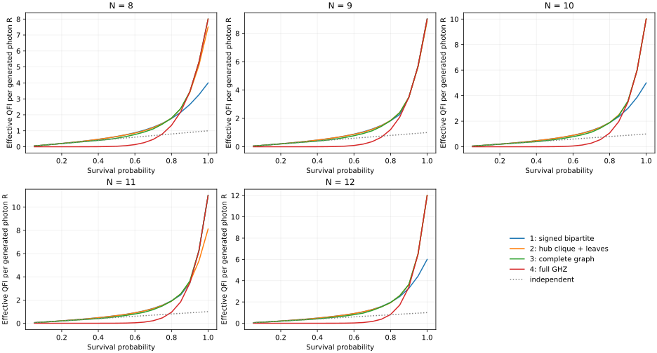

# N=8–12 structured weighted sensing: completed numerical search

**Best found within the recorded search budget. No global-optimality or exhaustive-sign claim.**

[All 100 conditions (CSV)](comparison.csv) · [Weights, axes and QFIMs (JSON)](best.json) · [Coverage](summary.json) · [Validation](validation.json)

|N|eta|Family 1 R|Family 2 R|Family 3 R|Full GHZ R|Best family|
|---:|---:|---:|---:|---:|---:|---:|
|8|0.20|0.207586478|0.207603949|0.200000000|0.000020480|2|
|8|0.50|0.640460502|0.639562264|0.533082738|0.031250000|1|
|8|0.80|1.769107813|1.784254999|1.795547571|1.342177280|3|
|8|0.90|2.645195305|3.393972581|3.443737680|3.443737680|4|
|9|0.20|0.208455952|0.207958176|0.200000000|0.000004608|1|
|9|0.50|0.644984309|0.646815090|0.546494489|0.017578125|2|
|9|0.80|1.834205319|1.856870580|1.838823479|1.207959552|2|
|9|0.90|3.486784401|3.478211157|3.486784401|3.486784401|4|
|10|0.20|0.209153550|0.208703246|0.200000000|0.000001024|1|
|10|0.50|0.650351889|0.651898389|0.557959658|0.009765625|2|
|10|0.80|1.886038705|1.891936023|1.882304991|1.073741824|2|
|10|0.90|3.003999568|3.513366087|3.576441911|3.486784401|3|
|11|0.20|0.209724859|0.209523333|0.200000000|0.000000225|1|
|11|0.50|0.661647411|0.656681481|0.564490294|0.005371094|1|
|11|0.80|1.927318297|1.902374427|1.918788411|0.944892805|1|
|11|0.90|3.451916557|3.536716541|3.632326874|3.451916557|3|
|12|0.20|0.210200659|0.210197924|0.200000000|0.000000049|1|
|12|0.50|0.671219775|0.666641259|0.576483033|0.002929688|1|
|12|0.80|1.960134760|1.927415888|1.950008291|0.824633721|1|
|12|0.90|3.286896496|3.619231482|3.653414451|3.389154438|3|

The full results retain the source record for each selected protocol. All generated photons, including lost photons, are counted. The criterion is an SLD-QFIM bound, not the CFI of a supplied readout. Classical loss records are retained; there is no loss-dependent input or setting mixture.

Total completed profile evaluations: 16479. Completed per-eta local refinements: 300.

## Interpretation

Family 1 includes a systematic permutation-symmetric sign subset and additional valid general sign samples. It is not a complete enumeration of the previously counted sign isomorphism classes. Family 2 compares every hub count and every positive/negative leaf-group size. Its three edge-type weights are sampled and then locally refined; the hub-hub weight may be positive or negative. Family 3 has no maximum number of vertex groups: the dense multistart branch perturbs every edge independently. A uniform-weight clique is additionally scanned and refined. Read the root README for the finite budgets and restricted rotation catalogue.
