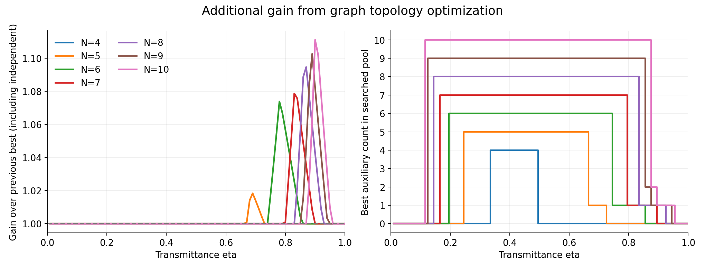
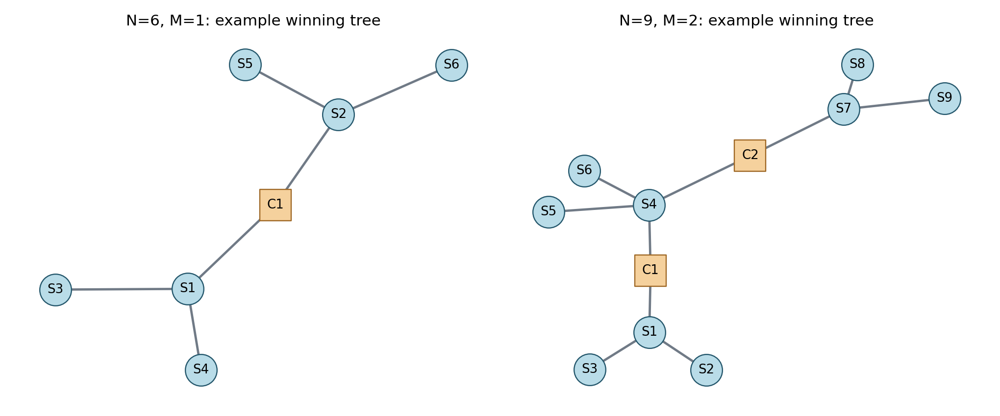

# 完全グラフに限定しない、光子数当たりの量子位相推定最適化

センサN=4〜10個、中央補助M=0〜N個を対象に、センサ間・センサ中央間・中央間の接続を変更して探索した。小さい系の全グラフ列挙、任意の辺を持つランダムグラフ、既知構造、発見した構造の拡張、および任意の辺の追加・削除を組み合わせた。

**結果：5〜10センサで、前回の完全グラフ系列の最良値を上回る構造を発見した。特にセンサの星型群を少数の中央光子でつなぐ木構造が有利だった。4センサは、今回の理想モデルの全グラフに対する最適値を連続する透過率全域で確認できた。5〜10センサの結果は探索範囲内の最良値であり、大域的最適性は未証明。**

## 条件

- 位相付与前にセンサ光子だけが独立な透過率etaの消失を受ける。中央補助は保持され損失しない。
- 生存集合は光子を消費せずに中央測定前に分かる。
- 中央測定はX/Y。損失集合に応じて基底を選び、結果に応じたセンサの局所Clifford操作を許す。操作は位相付与前。
- 各地点の位相phi_iは独立に未知。U_i=exp[−i phi_i (I−Z_i)/2]、目標は全N地点の平均。
- 損失・中央結果・記録付きランダム化を全て使い、試行を捨てない。センサの役割を試行ごとに入れ替える追加の対称化は導入していない。
- 評価量はF_eff/(N+M)。F_eff=1/(w^T F^+ w)、w=(1,…,1)/N。全条件のQFIMを先に確率で平均する。
- QFIを比較し、具体的読み出し測定のCFIは評価しない。光源成功率、CZ辺の生成コスト、中央の損失、保持時間、操作誤差は含めない。
- Nは比較の中で固定。Nも変える資源配分の最適化ではない。

## 主な結果

透過率eta=0.01,0.02,…,1.00を評価。前回の基準は「完全センサグラフ＋0〜N個の補助葉」の最良値と独立プローブの良いほう。以下の最大改善は0.01刻みのグリッド上の値。

|N|前回基準からの最大改善|そのeta|その点の補助数M|最適性の範囲|
|---:|---:|---:|---:|---|
|4|0%|—|—|理想モデル内の全グラフについて確認|
|5|約1.83%|0.69|1|探索した範囲の最良値|
|6|約7.39%|0.78|1|探索した範囲の最良値|
|7|約7.88%|0.83|1|探索した範囲の最良値|
|8|約9.47%|0.87|1|探索した範囲の最良値|
|9|約10.27%|0.89|1|探索した範囲の最良値|
|10|約11.12%|0.90|1|探索した範囲の最良値|



グリッド上での補助数の切替：

|N|独立プローブ|補助N個|補助2個|補助1個|補助なしのもつれたグラフ|
|---:|---|---|---|---|---|
|4|0.01〜0.33|0.34〜0.49|—|—|0.50〜1.00|
|5|0.01〜0.24|0.25〜0.66|—|0.67〜0.72|0.73〜1.00|
|6|0.01〜0.19|0.20〜0.74|—|0.75〜0.85|0.86〜1.00|
|7|0.01〜0.16|0.17〜0.79|—|0.80〜0.89|0.90〜1.00|
|8|0.01〜0.14|0.15〜0.83|—|0.84〜0.92|0.93〜1.00|
|9|0.01〜0.12|0.13〜0.85|0.86〜0.87|0.88〜0.94|0.95〜1.00|
|10|0.01〜0.11|0.12〜0.87|0.88〜0.89|0.90〜0.95|0.96〜1.00|

これはグリッド上で選んだ代表解の区間であり、連続パラメータでの厳密な切替境界ではない。同率点での全最適構成を列挙したものでもない。例えば独立プローブと全補助構成の交点eta=1/(N−1)では同率。

## 新しく見つかった構造



円Sはセンサ、四角Cは中央補助。左は3センサの星型を2群作り、群の中心センサ同士を中央補助1個を介して接続した構造。右は3センサの群を3つ作り、中央補助2個でつないだ構造。

左のN=6,M=1の辺（0から数えるセンサ0〜5、中央6）は

`[(0,2),(0,3),(0,6),(1,4),(1,5),(1,6)]`

で、7頂点6辺の木。eta=0.8でのF_eff/(N+M)は2.230272。前回の最良値2.110464を約5.68%上回る。

N=10,M=1では5センサ群を2つつないだ木が有利。eta=0.9で4.550298709を実現し、前回の最良値4.095から約11.12%改善した。

これらは毎回生存センサ全体のGHZを作り1試行上限を達成する構造ではない。残った部分の情報と少ない補助数の組合せによって、総生成光子数当たりで有利になる。

## 探索範囲と限界

**全グラフ列挙の部分**：NetworkX Graph Atlasの7頂点以下の全単純無向グラフに、センサと中央の役割を全て割り当てた。同じ役割内の番号交換は、共通透過率と平均位相のため性能を変えない。したがって、この生成法は役割を区別した全グラフを網羅する。非連結グラフも含む。

- N=4：M=0,1,2,3を全探索。
- N=5：M=0,1,2を全探索。
- N=6：M=0,1を全探索。
- N=7：M=0を全探索。
- 全NでM=Nは、既知の上限達成構成により、そのMでの大域最適値が既知。
- M>Nは、1試行上限をN+Mで割るとM=Nの既知構成に負けるため、追加探索は不要。

上のGraph Atlas＋全役割割当の生成数は計70,463件（同形や重複を含む）。重複する番号付き辺集合の再利用、測定後プロファイルの共有、上界による枝刈りを行った。

**それより大きい系**：完全グラフ、星、道、輪、二部グラフ、部分群の組合せ、任意の辺を持つランダムグラフ、辺の追加・削除、発見した木構造の全整数分割による拡張を調べた。さらに有利だった構造の全1辺変更と乱数を固定した2辺変更を調べた。接続を完全グラフや木だけに制限してはいない。これは有限の探索であり、全グラフを網羅しない。

中央X/Y設定はM≤5では全て列挙。大きいMでは代表設定＋乱数固定の設定を計32個選ぶ。実際の全設定数と使用設定数は詳細結果に記録する。発見した利得のある最終構造はM=1または2なので、その中央設定は全て列挙している。

今回の評価回数は計60,147回（再評価を含む）。大きいNの未探索グラフ・未使用中央設定に、さらに良い解がある可能性は残る。

## 計算法と最適化の証拠

光子損失は部分トレースとして扱う。中央測定と失われたセンサの部分トレースは交換できるので、中央X/Y設定ごとの純粋なセンサ安定化状態を計算し、全生存集合の混合状態の情報量を整数の安定化演算子から評価する。

平坦な非ゼロ固有値を持つ安定化混合状態では、局所Pauli P_iが残存安定化子と反交換すると、その軸の対角QFIは1。P_iP_jが安定化群に属し、両者が能動的なら、非対角QFIの絶対値は1になる。局所軸と符号の最適化で、残る相関をGHZ型ブロックに整理できる。

任意の方向dに対する符号付き局所操作の支持関数は|d|だけに依存する。正の平均重みでは、最適化方向をd≥0、sum(d)=Nに制限できる。各損失集合Sで可能な正相関ブロック行列をQとすると、最適情報量は凸最適化

\[
F_{\rm eff}^{*}=\min_{d\ge0,\;\sum_i d_i=N}
\sum_S p_S\max_Q d^TQd
\]

で求められる。最適化の双対重みから実現可能な条件別混合QFIMを組み立て、方向dのゼロ成分では記録付きの局所符号反転を混ぜて補正する。そのQFIMから直接計算した実現可能値と、方向dによる上界の差を記録した。探索で実際に解いた問題の最大相対差は約2.24e−9。

良い既知構成を超えないことが共通位相方向の上界から分かる候補は、操作最適化を解かずに除外した。この枝刈りにより全グラフ列挙の候補も効率よく比較している。

**4センサの連続区間の確認**：全探索から得られる167種類の上界多項式について、以下の3区間で基準との差を有理数のBernstein係数に変換した。501件すべてで係数が非負となったため、グリッド間も含めて次の上側包絡線が最適であることを確認した。

\[
\max\{\eta,\;\eta/2+3\eta^2/2,\;3\eta^2-3\eta^3+4\eta^4\}.
\]

切替はeta=1/3と1/2。`four_sensor_certificate.json`と再実行コードに有理数計算を収録。

## 独立検証

- 任意グラフ・損失・中央設定の312密度行列分岐について、局所Clifford生成子を直接列挙した支持関数と照合。最大絶対差5.33e−15。
- 完全グラフ系列の既存解析式と66条件で照合。最大相対差1.34e−15。
- 実際に見つけたN=5〜10の有利な8グラフについて、1〜4センサ生存の480分岐を密度行列で独立検証。最大絶対差2.67e−15。大きい系の全分岐を密度行列で列挙したわけではない。
- 操作最適化の実現可能QFIMと双対上界を比較し、最大相対差約2.24e−9。

## 再実行とファイル

Python 3.10以降を想定。リポジトリのルートから：

```bash
cd unrestricted_graph_search
python -m pip install -r requirements.txt
python run_all.py --fresh
```

`--fresh`は、この計算で生成した`results/catalog_N*.json.gz`キャッシュだけを削除して再構築する。省略するとキャッシュを再利用する。初回は全探索と構造拡張を含むため数分以上かかることがある。

- `results/best_by_eta.csv`：透過率ごとの発見した最良の補助数・情報量・前回からの利得。
- `results/best_graphs.json`：そのグラフの全辺リスト。センサは0〜N−1、中央はN〜N+M−1。
- `results/search_summary.json`：探索回数・グリッド上の切替・最適性の範囲。
- `results/results_N*.json.gz`：各Nの詳しい探索結果とQFIM、最適化方向、記録付き局所符号反転の平均値など。
- `results/comparison_N*.csv`：補助数ごとの実現可能値と探索プール内の上界。枝刈りで補助数ごとの最適値まで求めていない行は`per_auxiliary_count_exact=false`。この上界は大きい系の未探索グラフや未使用中央設定をカバーしない。
- `results/engine_validation.json`, `winner_validation.json`, `four_sensor_certificate.json`：検証記録。
- `results/*.png`：比較図とグラフ図。

大きいキャッシュは配布対象から除外し、固定乱数とソースコードから再生成できる。`summary.json`は中間出力なので、最終結果は`search_summary.json`を参照。
