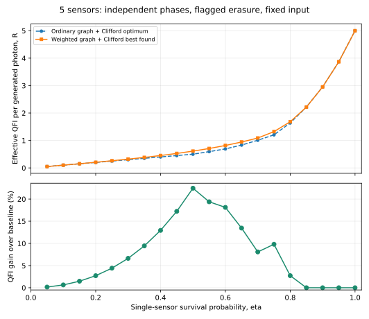
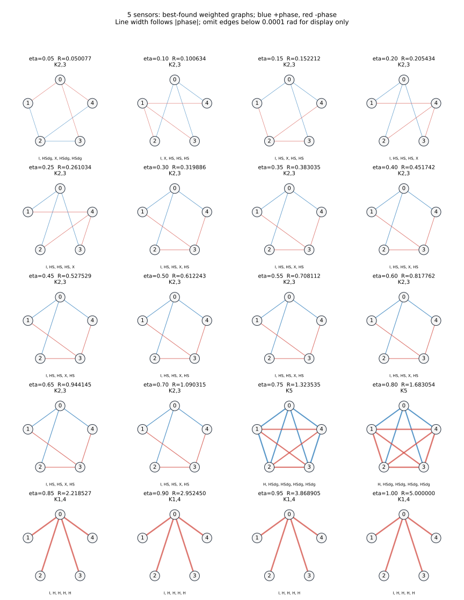
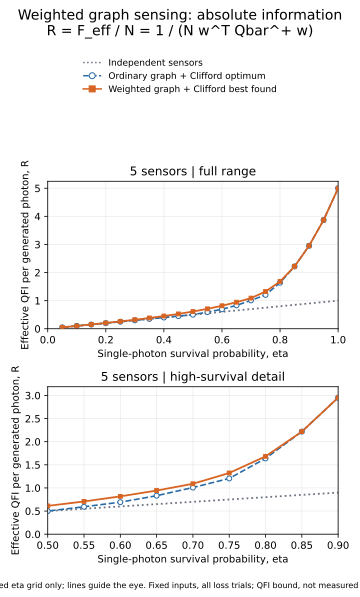

# 5センサ・重み付きグラフ＋固定Clifford：結果

**重みを変えると、従来の通常グラフ＋Clifford最適値を上回る構成が見つかった。**

20評価点のうち16点で更新。最大の有効QFI増加はeta=0.5で22.4486%。
局所回転はCliffordのまま。全試行の平均位相QCRBから評価し、損失した試行も除外していない。
**ここでの値は最良発見値であり、連続重みの大域最適値を証明したものではない。**



## 既存最適値との比較

R=1/[5 w^T Q(eta)^+ w]。w=ones(5)/5。Rが大きいほど平均位相の分散下限が小さい。
既存値は全通常グラフ・全局所Cliffordを調べた値で、最良GHZ分割と一致する。

|eta|既存Clifford最適値R|重み可変の最良発見R|QFI増加|
|---:|---:|---:|---:|
|0.05|0.050000000|0.050077006|0.1540%|
|0.10|0.100000000|0.100634400|0.6344%|
|0.15|0.150000000|0.152211822|1.4745%|
|0.20|0.200000000|0.205433502|2.7168%|
|0.25|0.250000000|0.261033660|4.4135%|
|0.30|0.300000000|0.319885574|6.6285%|
|0.35|0.350000000|0.383035229|9.4386%|
|0.40|0.400000000|0.451741950|12.9355%|
|0.45|0.450000000|0.527528936|17.2287%|
|0.50|0.500000000|0.612243030|22.4486%|
|0.55|0.593137255|0.708111536|19.3841%|
|0.60|0.692307692|0.817761823|18.1212%|
|0.65|0.832196970|0.944144884|13.4521%|
|0.70|1.008823529|1.090314746|8.0778%|
|0.75|1.205357143|1.323534875|9.8044%|
|0.80|1.638400000|1.683053627|2.7254%|
|0.85|2.218526563|2.218526563|0.0000%|
|0.90|2.952450000|2.952450000|0.0000%|
|0.95|3.868904688|3.868904688|0.0000%|
|1.00|5.000000000|5.000000000|0.0000%|

QFI増加率は分散や標準偏差の改善率とは異なる。eta=0.5ではRが約1.22449倍になり、
対応する分散下限は約18.33%低下する。

## 再現しやすい改善例

eta=0.50、phi=2/3 rad。頂点をA={0,3}、B={1,2,4}に分けたK2,3の6辺だけを使う。

|辺|制御位相の重み|
|---|---:|
|0–1、0–2、0–4|+2/3 rad|
|1–3、2–3、3–4|−2/3 rad|
|その他|0|

負の重みは2π−2/3 radと同じゲート。局所Cliffordはセンサ0〜4の順に
`[I, HS, HS, X, HS]`（右から作用）。有効位相軸は`[+Z, -Y, -Y, -Z, -Y]`。

この簡単な構成だけでR=0.612243029773となり、既存最適値0.5を超える。
平均位相の1試行あたりQCRBは0.326667663451（既存0.4）。
数値最適化の微小な辺重みを正確な0に置き換え、非ゼロ重みを±2/3へ丸めた、別途検算済みの構成。

```bash
python simple_witness.py --eta 0.5 --phi 0.6666666666666666
```

各etaの数値最良構成はbest_protocols.csvに10辺の重みと5個の局所ゲートを保存した。
読み出し測定基底の最適化をした結果ではない。

## 各透過率のグラフ構造



各パネルは保存済みの最良発見構成。節点番号は0〜4、全てセンサ。
青は正、赤は負の主値角（−π以上π未満）。辺の太さは角度の絶対値に対応。
下のゲート列は頂点番号順の局所Cliffordで、ゲート積は右から作用する。
図だけは絶対値0.0001 rad以下の辺を省略。元の重み・スコアは変更していない。
構造名は描画閾値に基づく分類であり、厳密な零重みや対称性の証明ではない。

[描画した辺と構造の一覧](graph_structures.json) ／ [全辺の正確な重みとゲート](best_protocols.csv)

## 探索方法

- 共通重みの粗い探索：全34同型代表×65重み×20生存確率。π以外にLC削減は使わない。
- 個別重み：全10辺の位相を独立に変え、辺なしも含む。
- 各重み評価で6^5通りの局所Clifford有効軸を調べる。同時全符号反転のみ同一視。
- 連続局所最適化：1,759初期値。成功終了は1759/1759回。
- 独立の集団探索：6回。成功終了は0/6回。
- 集団探索は100世代上限に達した候補も局所最適化して評価。大域探索の収束は主張しない。
- 再開後の実行時間：292.78秒。保存済みの粗い探索を再利用したため、その計算時間は含まない。
- 出力のsummary.jsonとoptimization_runs.csvに設定・環境・停止状況・ソースハッシュを保存。

## 混合状態の独立検算

一般の重みでは損失後のスペクトルは平坦でないため、一般の混合状態SLD公式で計算した。
CPゲートとCliffordを物理的に作用させた状態を部分トレースし、密度行列微分から独立にQFIMを再計算。

- ランダム入力12構成×32損失パターン。最大誤差2.55e-15。
- 保存した全20構成×32損失パターン。最大QFIM誤差1.59e-14。
- 保存スコアの最大誤差1.07e-14。
- 不均一で非ゼロの独立位相でも確認。最大誤差1.78e-15。
- 解析勾配の数値微分照合：最大誤差3.06e-11。
- 6^5=7,776通りの直接列挙とClifford削減が一致。
- 既存全探索結果との基準値照合：20点。

## 結論の範囲

通常のグラフ状態＋局所Cliffordの最適性は、重み付きグラフ状態まで広げると成立しない。
一方、新しく発見した構成が重み付きグラフ全体で最適であるかは未証明。
eta=0.85, 0.90, 0.95, 1.00では今回の探索で改善候補が見つからなかった。
これは未評価の中間透過率、任意局所回転を同時に許した場合、または具体的な局所測定CFIに関する結論ではない。

## 情報量そのものの比較（追加図）

既存の改善率の図に加えて、情報量そのものを表示する図を追加した。



縦軸は R = F_eff / N = 1 / (N w^T Qbar^+ w)。独立センサ、通常グラフ＋Cliffordの最適値、重み付きの最良発見値を比較する。
上段は全範囲、下段は透過率0.50〜0.90。全て元のCSVの保存評価点であり、追加最適化や曲線の平滑化は行っていない。

[1試行当たりの有効QFI F_eff = N R](information_total.svg)
