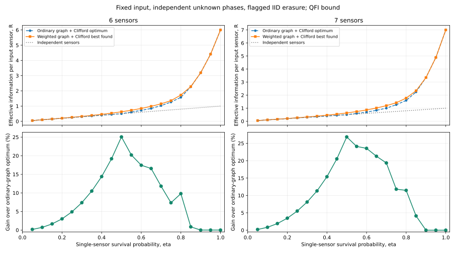
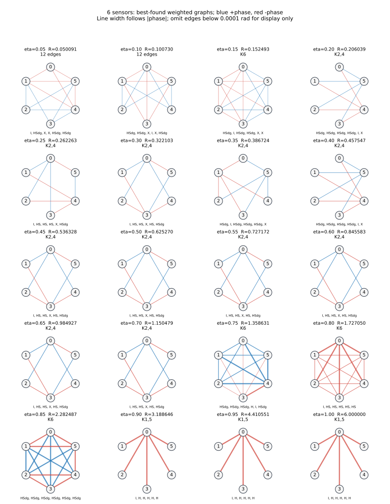
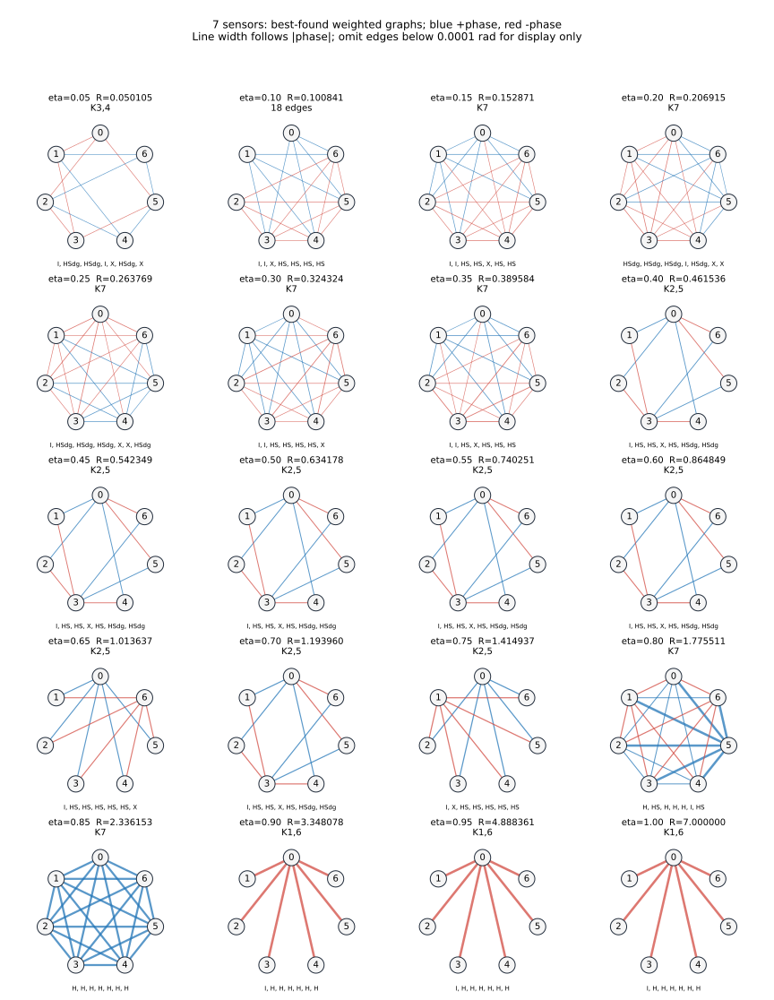
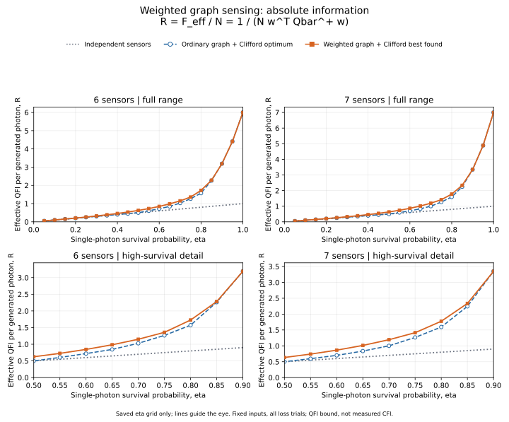

# 6・7センサ：重み付きグラフ＋固定Cliffordの探索結果

**各辺の重みを独立に最適化し、従来の通常グラフ＋固定Cliffordの全探索値と比較した。**

連続重みはヒューリスティック探索であり、保存値は最良発見値。大域最適性は未証明。
入力、損失モデル、独立未知位相の平均、全試行の扱いは5センサ探索と同じ。
Cliffordの確率混合、補助、適応的入力は使っていない。

|センサ数|改善した点数|最大QFI増加率|そのときのeta|従来R|最良発見R|
|---:|---:|---:|---:|---:|---:|
|6|17/20|25.0541%|0.50|0.500000000|0.625270470|
|7|17/20|26.8356%|0.50|0.500000000|0.634177753|

QFI増加率は分散・標準偏差の改善率とは異なる。Rがa倍なら分散下限は1/a倍。
R=1/[N w^T Q(eta)^+ w]、w=ones(N)/N。nu試行の平均位相分散下限は1/(nu N R)。

## 生存確率ごとの比較

|N|eta|通常グラフ最適R|重み可変の最良発見R|QFI増加率|描画上の構造|
|---:|---:|---:|---:|---:|---|
|6|0.05|0.050000000|0.050090605|0.1812%|12 edges|
|6|0.10|0.100000000|0.100730306|0.7303%|12 edges|
|6|0.15|0.150000000|0.152492846|1.6619%|K6|
|6|0.20|0.200000000|0.206038774|3.0194%|K2,4|
|6|0.25|0.250000000|0.262263400|4.9054%|K2,4|
|6|0.30|0.300000000|0.322102801|7.3676%|K2,4|
|6|0.35|0.350000000|0.386724046|10.4926%|K2,4|
|6|0.40|0.400000000|0.457547458|14.3869%|K2,4|
|6|0.45|0.450000000|0.536328331|19.1841%|K2,4|
|6|0.50|0.500000000|0.625270470|25.0541%|K2,4|
|6|0.55|0.605000000|0.727171590|20.1937%|K2,4|
|6|0.60|0.720000000|0.845582617|17.4420%|K2,4|
|6|0.65|0.845000000|0.984926803|16.5594%|K2,4|
|6|0.70|1.029000000|1.150479161|11.8056%|K2,4|
|6|0.75|1.265625000|1.358630523|7.3486%|K6|
|6|0.80|1.572864000|1.727049504|9.8029%|K6|
|6|0.85|2.262897094|2.282486555|0.8657%|K6|
|6|0.90|3.188646000|3.188646000|0.0000%|K1,5|
|6|0.95|4.410551344|4.410551344|0.0000%|K1,5|
|6|1.00|6.000000000|6.000000000|0.0000%|K1,5|
|7|0.05|0.050000000|0.050104802|0.2096%|K3,4|
|7|0.10|0.100000000|0.100840623|0.8406%|18 edges|
|7|0.15|0.150000000|0.152871362|1.9142%|K7|
|7|0.20|0.200000000|0.206915068|3.4575%|K7|
|7|0.25|0.250000000|0.263768585|5.5074%|K7|
|7|0.30|0.300000000|0.324324183|8.1081%|K7|
|7|0.35|0.350000000|0.389583858|11.3097%|K7|
|7|0.40|0.400000000|0.461536279|15.3841%|K2,5|
|7|0.45|0.450000000|0.542349291|20.5221%|K2,5|
|7|0.50|0.500000000|0.634177753|26.8356%|K2,5|
|7|0.55|0.596478873|0.740250601|24.1034%|K2,5|
|7|0.60|0.700000000|0.864848604|23.5498%|K2,5|
|7|0.65|0.835815217|1.013636965|21.2752%|K2,5|
|7|0.70|1.000416667|1.193959977|19.3463%|K2,5|
|7|0.75|1.265625000|1.414937070|11.7975%|K2,5|
|7|0.80|1.592888889|1.775511304|11.4649%|K7|
|7|0.85|2.244039618|2.336153419|4.1048%|K7|
|7|0.90|3.348078300|3.348078300|0.0000%|K1,6|
|7|0.95|4.888361073|4.888361073|0.0000%|K1,6|
|7|1.00|7.000000000|7.000000000|0.0000%|K1,6|

## 各点のグラフ・重み・回転

図だけは絶対値0.0001 rad未満の辺を省略。計算と保存構成は丸めていない。
図の構造名はこの描画閾値に基づく分類であり、厳密な零重みや対称性の証明ではない。
青は正、赤は負の主値角。太さは絶対値に対応。節点は全てセンサ。
各図の下は頂点番号順の局所ゲート。ゲート積は右から作用。

### 6センサ

[各辺の正確な重みと各センサの回転：best_protocols_N6.csv](best_protocols_N6.csv)

### 7センサ

[各辺の正確な重みと各センサの回転：best_protocols_N7.csv](best_protocols_N7.csv)

## 探索範囲・停止条件

- 粗い探索：全同型代表N6=156、N7=1044。非連結・孤立頂点を含む。
- 共通重み[0,pi]の33点、生存確率[0.2, 0.5, 0.7, 0.85]。共役側の重複を省略。
- 全形状の共通重みを調べたが、各形状の全独立重みを全探索したわけではない。
- 各最終etaでは近い粗い点の上位候補を再評価し、全15／21辺の角度を独立に最適化。
- 全局所Cliffordの比較：6^6=46,656、6^7=279,936。全符号反転のみ同一視。
- 初期値：粗い上位候補、GHZ分割、5センサ構成の埋込み、符号付き二部グラフ、摂動、全辺ランダム。
- 通常・継続の局所最適化：4,076回。成功終了4,075回。これに加え各集団探索の候補を局所最適化。
- 集団探索：12回。成功終了0回。世代上限に達した探索も局所最適化して比較。
- 最適化中のみ正則化。保存スコアは正則化なし。元の基準構成も候補として保持。
- 通常グラフの比較基準は全GHZ分割を列挙し、従来の通常グラフ＋Clifford全探索結果とも照合。
- 最終の起動からの経過時間：12.67秒。並列ワーカー数6。
- 初回の設定保存から最終集計までの経過時間：2080.24秒。中断・再開・同時実行を含み、単独実行のベンチマークではない。
- 実行設定はconfiguration.json、各試行の停止理由・評価回数はoptimization_runs.csv。

## 独立検算

探索は一般混合状態SLD公式の低ランク表現を使用。スタビライザー状態とは仮定しない。
検算はCPとCliffordを物理的に作用させ、全損失で密度行列微分から別実装のSLD公式を計算。

- 保存した40構成、合計3840生存マスクを確認。
- 保存QFIMの最大誤差：1.73e-14。
- 保存Rの最大誤差：1.07e-14。
- 生存数集計・平均QFIMの最大誤差：8.88e-14。
- 非ゼロの独立位相4構成：最大誤差2e-15。
- ランダム入力等と元の全密度行列カーネルの誤差：5.36e-15。
- 解析勾配と有限差分：最大誤差2.22e-11。
- 5センサの全20保存最良値を再現：最大誤差3.55e-15。
- 従来の6・7センサ全探索基準値と40点を照合：最大誤差2.66e-15。

## 結論の範囲

改善は、同じモデルで通常グラフ＋固定Cliffordの最良値を上回る実行可能な重み付き構成があることを示す。
改善のない点も、未探索の重みで改善できないとは証明していない。
重み付きグラフ全体の最適性、任意局所回転との同時最適化、局所読み出しの達成可能性、
生成成功率・ゲート誤差を含めた実験上の優位性は別の問題。

## 情報量そのものの比較（追加図）

既存の改善率の図に加えて、情報量そのものを表示する図を追加した。

縦軸は R = F_eff / N = 1 / (N w^T Qbar^+ w)。独立センサ、通常グラフ＋Cliffordの最適値、重み付きの最良発見値を比較する。
上段は全範囲、下段は透過率0.50〜0.90。全て元のCSVの保存評価点であり、追加最適化や曲線の平滑化は行っていない。

[1試行当たりの有効QFI F_eff = N R](information_total.svg)

[5・6・7センサを並べた情報量の比較図](information_N5_6_7.svg)
